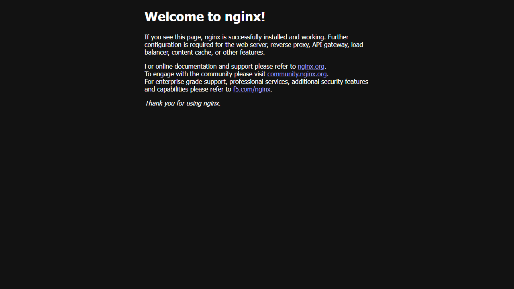

# Exercise 1 - Kubernetes Getting Started (Hello Pod)

## Aim
To start a Kubernetes cluster using Minikube, run nginx as a Pod (as Zepto's storefront app),
expose it using a NodePort service and open it in the browser.

## Files
- `hello-k8s-pod.yaml` - pod file for hello-k8s (nginx image, port 80)
- `hello-k8s-service.yaml` - NodePort service file for hello-k8s
- `commands.ps1` - all the commands I used
- `nginx-welcome.png` - screenshot of the nginx page

Note: In the exercise the pod and service are created using `kubectl run` and `kubectl expose`.
I also wrote the same pod and service as YAML files and ran them using `kubectl apply`.
Same name `hello-k8s` and label `run=hello-k8s` is used in both.

## Software used
- Windows 11 (PowerShell)
- Docker Desktop 29.8.2
- minikube v1.38.1 (docker driver)
- kubectl v1.36.4

## Procedure

1. Start minikube
   ```powershell
   minikube start --driver=docker
   ```
2. Create the pod using nginx image
   ```powershell
   kubectl run hello-k8s --image=nginx --port=80
   ```
3. Check if pod is running
   ```powershell
   kubectl get pods
   ```
4. Expose the pod as NodePort service
   ```powershell
   kubectl expose pod hello-k8s --type=NodePort --port=80
   kubectl get svc hello-k8s
   ```
5. Open the app in browser
   ```powershell
   minikube service hello-k8s
   ```
   (On Windows with docker driver this opens a tunnel on 127.0.0.1, so the terminal should be kept open.)
6. Check the page from terminal and see pod details
   ```powershell
   curl.exe -s http://127.0.0.1:54552
   kubectl get pods -o wide
   kubectl describe pod hello-k8s
   ```
   (54552 is the tunnel port I got from `minikube service`. It changes every time, so use the port shown in your own output.)
7. Delete the pod and service, then create them again using the YAML files
   ```powershell
   kubectl delete service hello-k8s
   kubectl delete pod hello-k8s
   kubectl apply -f hello-k8s-pod.yaml
   kubectl wait --for=condition=Ready pod/hello-k8s --timeout=180s
   kubectl apply -f hello-k8s-service.yaml
   kubectl get pods,svc -l run=hello-k8s
   minikube service hello-k8s
   ```

## Output

**Step 1 - minikube start** (download progress bar lines removed)
```
😄  minikube v1.38.1 on Microsoft Windows 11 Home Single Language 25H2
🎉  minikube 1.39.0 is available! Download it: https://github.com/kubernetes/minikube/releases/tag/v1.39.0
💡  To disable this notice, run: 'minikube config set WantUpdateNotification false'

✨  Using the docker driver based on user configuration
❗  Starting v1.39.0, minikube will default to "containerd" container runtime. See #21973 for more info.
📌  Using Docker Desktop driver with root privileges
👍  Starting "minikube" primary control-plane node in "minikube" cluster
🚜  Pulling base image v0.0.50 ...
🔗  Configuring bridge CNI (Container Networking Interface) ...
🔎  Verifying Kubernetes components...
    ▪ Using image gcr.io/k8s-minikube/storage-provisioner:v5
🌟  Enabled addons: storage-provisioner, default-storageclass
🏄  Done! kubectl is now configured to use "minikube" cluster and "default" namespace by default
```

**Step 2 - kubectl run**
```
pod/hello-k8s created
```

**Step 3 - kubectl get pods**
```
NAME        READY   STATUS    RESTARTS   AGE
hello-k8s   1/1     Running   0          16s
```

**Step 4 - kubectl expose**
```
service/hello-k8s exposed
NAME        TYPE       CLUSTER-IP     EXTERNAL-IP   PORT(S)        AGE
hello-k8s   NodePort   10.100.16.26   <none>        80:31976/TCP   0s
```

**Step 5 - minikube service hello-k8s**
```
┌───────────┬───────────┬─────────────┬───────────────────────────┐
│ NAMESPACE │   NAME    │ TARGET PORT │            URL            │
├───────────┼───────────┼─────────────┼───────────────────────────┤
│ default   │ hello-k8s │ 80          │ http://192.168.49.2:31976 │
└───────────┴───────────┴─────────────┴───────────────────────────┘
🔗  Starting tunnel for service hello-k8s.
┌───────────┬───────────┬─────────────┬────────────────────────┐
│ NAMESPACE │   NAME    │ TARGET PORT │          URL           │
├───────────┼───────────┼─────────────┼────────────────────────┤
│ default   │ hello-k8s │             │ http://127.0.0.1:54552 │
└───────────┴───────────┴─────────────┴────────────────────────┘
🎉  Opening service default/hello-k8s in default browser...
```

nginx page at http://127.0.0.1:54552:



**Step 6 - curl (first few lines)**
```
<!DOCTYPE html>
<html>
<head>
<title>Welcome to nginx!</title>
<style>
html { color-scheme: light dark; }
body { width: 35em; margin: 0 auto;
font-family: Tahoma, Verdana, Arial, sans-serif; }
</style>
</head>
<body>
<h1>Welcome to nginx!</h1>
<p>If you see this page, nginx is successfully installed and working.
Further configuration is required for the web server, reverse proxy, 
API gateway, load balancer, content cache, or other features.</p>
```

kubectl get pods -o wide
```
NAME        READY   STATUS    RESTARTS   AGE   IP           NODE       NOMINATED NODE   READINESS GATES
hello-k8s   1/1     Running   0          36s   10.244.0.3   minikube   <none>           <none>
```

kubectl describe pod hello-k8s (first few lines)
```
Name:             hello-k8s
Namespace:        default
Priority:         0
Service Account:  default
Node:             minikube/192.168.49.2
Start Time:       Tue, 20 Oct 2026 22:16:16 +0530
Labels:           run=hello-k8s
Annotations:      <none>
Status:           Running
IP:               10.244.0.3
IPs:
  IP:  10.244.0.3
Containers:
  hello-k8s:
    Container ID:   docker://b9fb5a0325d3985c4914eeb1b8f49ba8ba546b18795de6875e56c2679af7dea8
    Image:          nginx
    Image ID:       docker-pullable://nginx@sha256:bc4cad49969aaf95eb4eecec5572846f86e59f1e8332aba36ed64b91aff8b724
    Port:           80/TCP
    Host Port:      0/TCP
    State:          Running
      Started:      Tue, 20 Oct 2026 22:16:31 +0530
    Ready:          True
    Restart Count:  0
```

**Step 7 - using YAML files**
```
service "hello-k8s" deleted from default namespace
pod "hello-k8s" deleted from default namespace
pod/hello-k8s created
pod/hello-k8s condition met
service/hello-k8s created
NAME            READY   STATUS    RESTARTS   AGE
pod/hello-k8s   1/1     Running   0          5s

NAME                TYPE       CLUSTER-IP     EXTERNAL-IP   PORT(S)        AGE
service/hello-k8s   NodePort   10.98.30.241   <none>        80:31073/TCP   0s
```

minikube service hello-k8s and curl http://127.0.0.1:63635 (title and heading lines)
```
┌───────────┬───────────┬─────────────┬───────────────────────────┐
│ NAMESPACE │   NAME    │ TARGET PORT │            URL            │
├───────────┼───────────┼─────────────┼───────────────────────────┤
│ default   │ hello-k8s │ 80          │ http://192.168.49.2:31073 │
└───────────┴───────────┴─────────────┴───────────────────────────┘
🔗  Starting tunnel for service hello-k8s.
┌───────────┬───────────┬─────────────┬────────────────────────┐
│ NAMESPACE │   NAME    │ TARGET PORT │          URL           │
├───────────┼───────────┼─────────────┼────────────────────────┤
│ default   │ hello-k8s │             │ http://127.0.0.1:63635 │
└───────────┴───────────┴─────────────┴────────────────────────┘
🎉  Opening service default/hello-k8s in default browser...

<title>Welcome to nginx!</title>
<h1>Welcome to nginx!</h1>
```

## Observations
- minikube started a single node cluster inside a docker container.
- `kubectl run` created the pod hello-k8s with label `run=hello-k8s`. It got IP 10.244.0.3 on node minikube.
- `kubectl expose` created a NodePort service. Port 80 was mapped to NodePort 31976.
- With docker driver on Windows the node IP 192.168.49.2 cannot be opened directly, so
  `minikube service` made a tunnel on 127.0.0.1:54552.
- The nginx welcome page opened, so the pod is running and the service is working.
- It worked the same way with the YAML files also. Since I did not give a nodePort in the
  service file, Kubernetes gave a different port (31073).

## Result
nginx was deployed as a pod in minikube, exposed using a NodePort service, and the nginx
welcome page was opened successfully.

## Cleanup
Stopped the minikube service tunnel (Ctrl+C) and deleted the pod and service:
```powershell
kubectl delete -f hello-k8s-service.yaml
kubectl delete -f hello-k8s-pod.yaml
kubectl get pods,svc
```
Output:
```
service "hello-k8s" deleted from default namespace
pod "hello-k8s" deleted from default namespace
NAME                 TYPE        CLUSTER-IP   EXTERNAL-IP   PORT(S)   AGE
service/kubernetes   ClusterIP   10.96.0.1    <none>        443/TCP   7m10s
```
