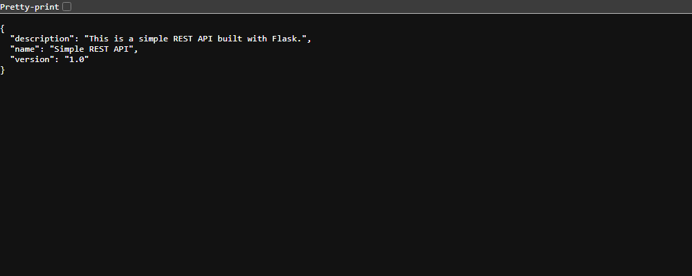

# Exercise 4 - Docker Networking with multiple containers

## Aim
To create a user defined bridge network in Docker, run a Flask web server, a MySQL database and a
Redis cache as 3 containers on that network, and check that the containers can reach each other by name.

## Files
- `app.py` - simple Flask REST API with `/about` route on port 5001
- `requirements.txt` - Flask 2.0.1 and Werkzeug 2.0.3
- `Dockerfile` - builds the `flask-api` image from python:3.9-slim (also installs ping)
- `commands.ps1` - all the commands I used
- `flask-about.png` - screenshot of http://localhost:5001/about

Notes (problems I got with the exercise files and how I fixed them):
1. `mysql:latest` exited with `Database is uninitialized and password option is not specified`.
   So I added `-e MYSQL_ROOT_PASSWORD=rootpass` to the mysql `docker run` command.
2. The flask container exited with `ImportError: cannot import name 'url_quote' from 'werkzeug.urls'`.
   Flask 2.0.1 installs the newest Werkzeug (3.1.9) which removed `url_quote`. So I added
   `Werkzeug==2.0.3` in `requirements.txt`.
3. After that flask was running but `curl http://localhost:5001/about` gave an empty reply, because
   `app.run()` was listening only on 127.0.0.1 inside the container. I changed it to
   `app.run(debug=True, host='0.0.0.0', port=5001)`.
4. `ping` is not there in python:3.9-slim (`executable file not found in $PATH`). I added
   `iputils-ping` in the Dockerfile.
5. `docker exec -it flask bash` and then `ping` needs an interactive terminal, so I ran
   `docker exec flask ping -c 3 mysql` which does the same thing in one command.

## Software used
- Windows 11 (PowerShell)
- Docker Desktop 29.8.2 (context `desktop-linux`)

## Procedure
1. Create a bridge network
   ```powershell
   docker network create --driver bridge my-bridge-net
   ```
2. Verify the network
   ```powershell
   docker network ls
   ```
3. Inspect the network
   ```powershell
   docker network inspect my-bridge-net
   ```
4. Create `app.py`, `requirements.txt` and `Dockerfile`, build the image and launch the 3 containers
   ```powershell
   docker build -t flask-api .
   docker run -d --name mysql --net=my-bridge-net mysql:latest
   docker run -d --name redis --net=my-bridge-net redis:latest
   docker run -d --name flask --net=my-bridge-net -p 5001:5001 flask-api
   docker ps -a --filter network=my-bridge-net
   ```
5. Check why mysql and flask exited, fix them (see Notes) and run them again
   ```powershell
   docker logs mysql
   docker logs flask
   docker rm mysql flask
   docker build -t flask-api .
   docker run -d --name mysql --net=my-bridge-net -e MYSQL_ROOT_PASSWORD=rootpass mysql:latest
   docker run -d --name flask --net=my-bridge-net -p 5001:5001 flask-api
   curl.exe -s http://localhost:5001/about
   ```
   (In PowerShell `curl` is a short name for `Invoke-WebRequest`, so I used `curl.exe` to run the real curl.)
6. Test connectivity from the flask container
   ```powershell
   docker exec flask ping -c 3 mysql
   docker exec flask ping -c 3 redis
   docker network inspect my-bridge-net --format "{{range .Containers}}{{.Name}} {{.IPv4Address}}{{println}}{{end}}"
   ```
7. Clean up
   ```powershell
   docker stop mysql redis flask
   docker rm mysql redis flask
   docker network rm my-bridge-net
   ```

## Output

**Task 1 - docker network create --driver bridge my-bridge-net**
```
d4e7786636346bec512f6ac3170e3e56a57072c6b99350cab413efcc16ef70fd
```

**Task 2 - docker network ls**
```
NETWORK ID     NAME            DRIVER    SCOPE
300c60e98884   bridge          bridge    local
0a88321651f4   host            host      local
fb286052aaf0   minikube        bridge    local
d4e778663634   my-bridge-net   bridge    local
57913a25b47d   none            null      local
```

**Task 3 - docker network inspect my-bridge-net**
```
[
    {
        "Name": "my-bridge-net",
        "Id": "d4e7786636346bec512f6ac3170e3e56a57072c6b99350cab413efcc16ef70fd",
        "Created": "2026-10-20T18:31:57.905730946Z",
        "Scope": "local",
        "Driver": "bridge",
        "EnableIPv4": true,
        "EnableIPv6": false,
        "IPAM": {
            "Driver": "default",
            "Options": {},
            "Config": [
                {
                    "Subnet": "172.18.0.0/16",
                    "Gateway": "172.18.0.1"
                }
            ]
        },
        "Internal": false,
        "Attachable": false,
        "Ingress": false,
        "ConfigFrom": {
            "Network": ""
        },
        "ConfigOnly": false,
        "Options": {
            "com.docker.network.enable_ipv4": "true",
            "com.docker.network.enable_ipv6": "false"
        },
        "Labels": {},
        "Containers": {},
        "Status": {
            "IPAM": {
                "Subnets": {
                    "172.18.0.0/16": {
                        "IPsInUse": 3,
                        "DynamicIPsAvailable": 65533
                    }
                }
            }
        }
    }
]
```

**Task 4 - docker build -t flask-api .** (first build, layer download lines removed)
```
#0 building with "desktop-linux" instance using docker driver
#1 [internal] load build definition from Dockerfile
#1 transferring dockerfile: 498B 0.0s done
#1 DONE 0.1s
#2 [internal] load metadata for docker.io/library/python:3.9-slim
#2 DONE 3.6s
#6 [1/5] FROM docker.io/library/python:3.9-slim@sha256:2d97f6910b16bd338d3060f261f53f144965f755599aab1acda1e13cf1731b1b
#6 DONE 4.6s
#7 [2/5] WORKDIR /app
#7 DONE 0.3s
#8 [3/5] COPY requirements.txt .
#8 DONE 0.1s
#9 [4/5] COPY app.py .
#9 DONE 0.1s
#10 [5/5] RUN pip install --no-cache-dir -r requirements.txt
#10 2.918 Collecting Flask==2.0.1
#10 3.285 Collecting Werkzeug>=2.0
#10 3.299   Downloading werkzeug-3.1.9-py3-none-any.whl (228 kB)
#10 4.188 Successfully installed Flask-2.0.1 Jinja2-3.1.6 MarkupSafe-3.0.4 Werkzeug-3.1.9 click-8.1.8 itsdangerous-2.2.0
#10 DONE 4.5s
#11 exporting to image
#11 naming to docker.io/library/flask-api:latest done
#11 DONE 3.5s
```

docker run (mysql and redis image pull lines removed)
```
Status: Downloaded newer image for mysql:latest
94c002c934f589dfd3f08fc6043f09f9a4deb17ffd06fc7ca909a310dc9ce978
Status: Downloaded newer image for redis:latest
4593dbbe51d8cfad2b2363c533ff4a46c5390014b1a74b2e8e46bf71640acb7a
4dc8e3415a228f0e1bfffb2c339b4f71b8ced3cae370c3e3759d90a33b49b6af
```

docker ps -a --filter network=my-bridge-net
```
NAMES     IMAGE          STATUS                      PORTS
flask     flask-api      Exited (1) 14 seconds ago   
redis     redis:latest   Up 16 seconds               6379/tcp
mysql     mysql:latest   Exited (1) 24 seconds ago
```

**Error 1 - docker logs mysql**
```
2026-10-20 18:32:51+00:00 [Note] [Entrypoint]: Entrypoint script for MySQL Server 26.7.0-1.el9 started.
2026-10-20 18:32:52+00:00 [Note] [Entrypoint]: Switching to dedicated user 'mysql'
2026-10-20 18:32:52+00:00 [Note] [Entrypoint]: Entrypoint script for MySQL Server 26.7.0-1.el9 started.
2026-10-20 18:32:52+00:00 [ERROR] [Entrypoint]: Database is uninitialized and password option is not specified
    You need to specify one of the following as an environment variable:
    - MYSQL_ROOT_PASSWORD
    - MYSQL_ALLOW_EMPTY_PASSWORD
    - MYSQL_RANDOM_ROOT_PASSWORD
```

**Error 2 - docker logs flask**
```
Traceback (most recent call last):
  File "/app/app.py", line 1, in <module>
    from flask import Flask, jsonify
  File "/usr/local/lib/python3.9/site-packages/flask/__init__.py", line 7, in <module>
    from .app import Flask as Flask
  File "/usr/local/lib/python3.9/site-packages/flask/app.py", line 28, in <module>
    from . import cli
  File "/usr/local/lib/python3.9/site-packages/flask/cli.py", line 18, in <module>
    from .helpers import get_debug_flag
  File "/usr/local/lib/python3.9/site-packages/flask/helpers.py", line 16, in <module>
    from werkzeug.urls import url_quote
ImportError: cannot import name 'url_quote' from 'werkzeug.urls' (/usr/local/lib/python3.9/site-packages/werkzeug/urls.py)
```

**After fix 1 and 2** (Werkzeug 2.0.3 added and mysql run with password)
```
#9 3.966 Successfully installed Flask-2.0.1 Jinja2-3.1.6 MarkupSafe-3.0.4 Werkzeug-2.0.3 click-8.1.8 itsdangerous-2.2.0
#10 naming to docker.io/library/flask-api:latest done
fffe9118203388712a411b5b93f039f1539ef250c17fecf15fd2d385a4101227
24c8315b5fe321c62c0eec93b75dd4025b4c0b4d43f6fe94627310c73509a50a
```
```
NAMES     IMAGE          STATUS              PORTS
flask     flask-api      Up 20 seconds       0.0.0.0:5001->5001/tcp, [::]:5001->5001/tcp
mysql     mysql:latest   Up 21 seconds       3306/tcp, 33060/tcp
redis     redis:latest   Up About a minute   6379/tcp
```

**Error 3 - flask listening only on 127.0.0.1** (docker logs flask, then curl gave empty reply, exit code 52)
```
 * Serving Flask app 'app' (lazy loading)
 * Environment: production
   WARNING: This is a development server. Do not use it in a production deployment.
   Use a production WSGI server instead.
 * Debug mode: on
 * Running on http://127.0.0.1:5001/ (Press CTRL+C to quit)
 * Restarting with stat
 * Debugger is active!
 * Debugger PIN: 605-516-035
```

**After fix 3** (host='0.0.0.0') - docker logs flask
```
 * Serving Flask app 'app' (lazy loading)
 * Environment: production
   WARNING: This is a development server. Do not use it in a production deployment.
   Use a production WSGI server instead.
 * Debug mode: on
 * Running on all addresses.
   WARNING: This is a development server. Do not use it in a production deployment.
 * Running on http://172.18.0.4:5001/ (Press CTRL+C to quit)
 * Restarting with stat
 * Debugger is active!
 * Debugger PIN: 864-019-805
```

curl.exe -s http://localhost:5001/about
```
{
  "description": "This is a simple REST API built with Flask.", 
  "name": "Simple REST API", 
  "version": "1.0"
}
```

docker ps --filter network=my-bridge-net
```
CONTAINER ID   NAMES     IMAGE          STATUS              PORTS
3d1b20f2f512   flask     flask-api      Up 5 seconds        0.0.0.0:5001->5001/tcp, [::]:5001->5001/tcp
fffe91182033   mysql     mysql:latest   Up 49 seconds       3306/tcp, 33060/tcp
4593dbbe51d8   redis     redis:latest   Up About a minute   6379/tcp
```

Page at http://localhost:5001/about:



**Task 5 - Error 4 - docker exec flask ping -c 3 mysql** (before adding iputils-ping)
```
OCI runtime exec failed: exec failed: unable to start container process: exec: "ping": executable file not found in $PATH
```

After adding iputils-ping to the Dockerfile and rebuilding
```
#10 [6/6] RUN apt-get update && apt-get install -y --no-install-recommends iputils-ping && rm -rf /var/lib/apt/lists/*
#10 7.912 Setting up iputils-ping (3:20240905-3) ...
#11 naming to docker.io/library/flask-api:latest done
48053f3f327a5511c1f646123ebfafe12dc0b7b100337c6dcda55326505b25b0
```

docker exec flask ping -c 3 mysql
```
PING mysql (172.18.0.3) 56(84) bytes of data.
64 bytes from mysql.my-bridge-net (172.18.0.3): icmp_seq=1 ttl=64 time=2.30 ms
64 bytes from mysql.my-bridge-net (172.18.0.3): icmp_seq=2 ttl=64 time=0.187 ms
64 bytes from mysql.my-bridge-net (172.18.0.3): icmp_seq=3 ttl=64 time=0.099 ms

--- mysql ping statistics ---
3 packets transmitted, 3 received, 0% packet loss, time 2008ms
rtt min/avg/max/mdev = 0.099/0.861/2.298/1.016 ms
```

docker exec flask ping -c 3 redis
```
PING redis (172.18.0.2) 56(84) bytes of data.
64 bytes from redis.my-bridge-net (172.18.0.2): icmp_seq=1 ttl=64 time=1.67 ms
64 bytes from redis.my-bridge-net (172.18.0.2): icmp_seq=2 ttl=64 time=0.120 ms
64 bytes from redis.my-bridge-net (172.18.0.2): icmp_seq=3 ttl=64 time=0.262 ms

--- redis ping statistics ---
3 packets transmitted, 3 received, 0% packet loss, time 2029ms
rtt min/avg/max/mdev = 0.120/0.682/1.665/0.697 ms
```

Containers on my-bridge-net
```
redis 172.18.0.2/16
flask 172.18.0.4/16
mysql 172.18.0.3/16
```

## Observations
- The new bridge network `my-bridge-net` got the subnet 172.18.0.0/16 with gateway 172.18.0.1.
- All 3 containers got IPs from this subnet (redis .2, mysql .3, flask .4).
- From the flask container I could ping `mysql` and `redis` using only their container names. Docker's
  built-in DNS on a user defined bridge network converts the name to the IP (`mysql.my-bridge-net`).
- Only the flask container was published to the host with `-p 5001:5001`. mysql (3306) and redis (6379)
  are only reachable inside the network.
- For `-p` to work the app inside the container must listen on 0.0.0.0, not 127.0.0.1.
- The mysql image needs a root password environment variable, otherwise it does not start.

## Result
A user defined bridge network was created, Flask, MySQL and Redis containers were run on it, the Flask
API was accessed from the host on port 5001, and the containers were able to reach each other by name.

## Cleanup
```powershell
docker stop mysql redis flask
docker rm mysql redis flask
docker network rm my-bridge-net
docker network ls
```
Output:
```
mysql
redis
flask
mysql
redis
flask
my-bridge-net
NETWORK ID     NAME       DRIVER    SCOPE
300c60e98884   bridge     bridge    local
0a88321651f4   host       host      local
fb286052aaf0   minikube   bridge    local
57913a25b47d   none       null      local
```
