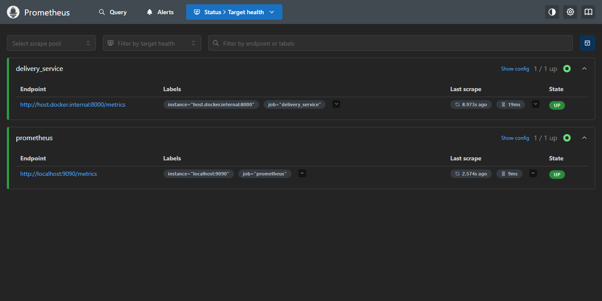
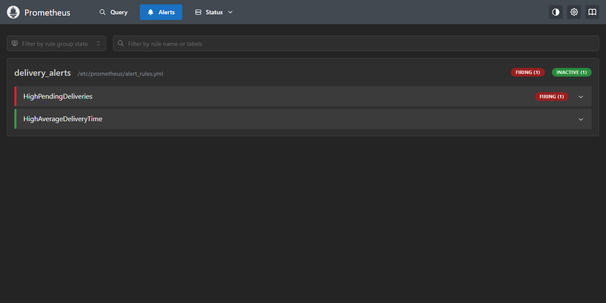
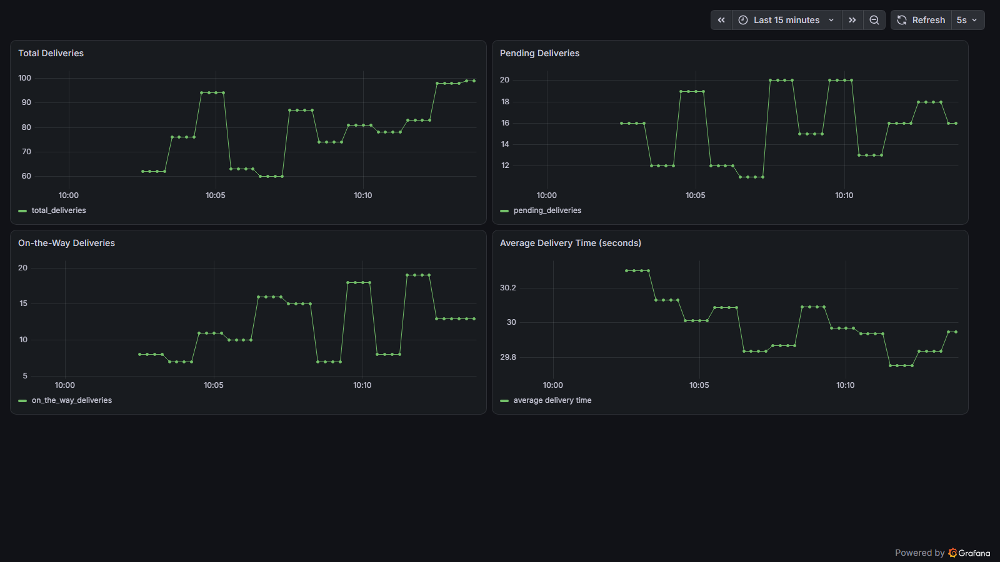
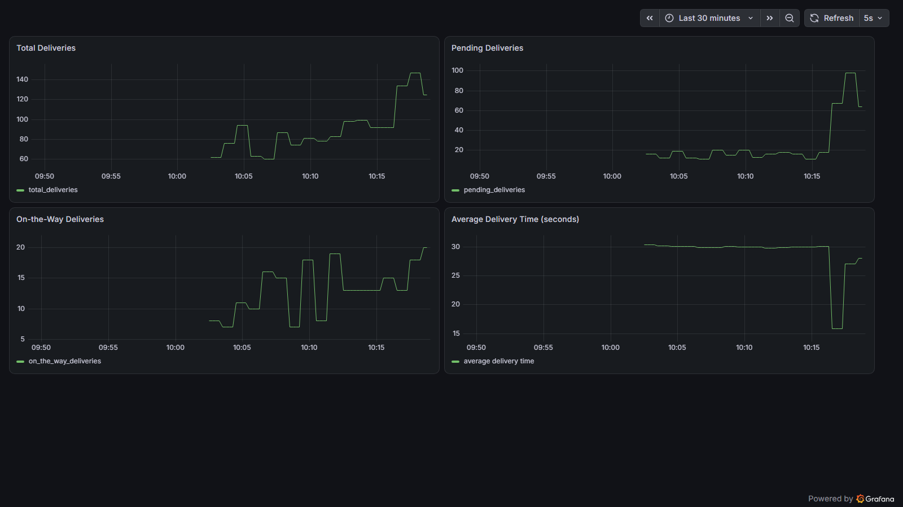
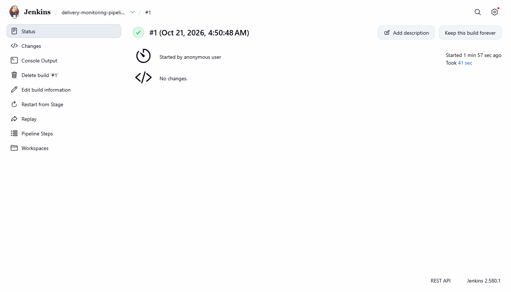

# Exercise 6 - Real-Time Operations Monitoring and Alerting (Prometheus, Grafana, Jenkins)

## Aim
To simulate delivery metrics of a delivery service using a Python app, collect them with Prometheus,
set up alert rules, show the metrics on a Grafana dashboard, and run the whole setup using a Jenkins pipeline.

## Files
- `delivery_metrics.py` - Python app that creates delivery metrics every second and serves them on port 8000 at `/metrics`
- `prometheus.yml` - Prometheus config (scrapes itself and the delivery app, loads the alert rules)
- `alert_rules.yml` - alerts `HighPendingDeliveries` (pending > 10 for 15s) and `HighAverageDeliveryTime` (average > 30)
- `Dockerfile` - builds the `delivery_metrics` image (used by the Jenkins pipeline)
- `Jenkinsfile` - pipeline that checks docker, copies the files, builds and runs the app, and runs Prometheus and Grafana
- `jenkins.Dockerfile` - Jenkins image with docker CLI and pipeline plugins
- `grafana-dashboard.json` - Grafana dashboard with the 4 panels
- `commands.ps1` - all the commands I used
- Screenshots: `prometheus-targets.png`, `prometheus-alerts.png`, `grafana-dashboard.png`,
  `grafana-dashboard-step6.png`, `jenkins-pipeline.png`

Notes (problems in the exercise file and what I changed):
1. The exercise says `prometheus.ym` and `alerts_rules.yml` but the commands use `prometheus.yml` and
   `alert_rules.yml`. I used `prometheus.yml` and `alert_rules.yml`.
2. `172.17.0.1` and `--network=host` are for Linux. On Windows with Docker Desktop I used
   `host.docker.internal:8000` as the target in `prometheus.yml`, `-p 9090:9090` for Prometheus, and
   `http://host.docker.internal:9090` as the Grafana data source URL (the exercise note also says this).
3. The Jenkinsfile builds a `delivery_metrics` image but there was no Dockerfile in the exercise, so I wrote one.
4. The plain `jenkins/jenkins:lts` image has no docker command (`"docker": executable file not found`),
   so the pipeline cannot run in it. I made `jenkins.Dockerfile` (adds docker CLI and the pipeline plugins)
   and ran it with the docker socket mounted. The setup wizard was turned off for this run.
5. In the Jenkinsfile, `/path/to/your/local/files` was changed to `/delivery_monitoring` (this folder is
   mounted there), and `Dockerfile` is also copied to the workspace.
6. `-v $WORKSPACE/prometheus.yml:...` does not work because the workspace is inside the Jenkins
   container and docker cannot see that path. So the pipeline creates the Prometheus container and uses
   `docker cp` to copy the two files into it, then starts it.
7. I added `docker rm -f ... || true` before starting the containers, so the pipeline can be run again.
8. Grafana was started with anonymous viewer access (`GF_AUTH_ANONYMOUS_ENABLED`) so the dashboard
   can be opened without logging in. Login with admin/admin still works.
9. I added the data source and the dashboard using the Grafana HTTP API (same settings as in the UI steps).

## Software used
- Windows 11 (PowerShell), Docker Desktop 29.8.2
- Python 3.11.7, prometheus-client 0.26.0
- Prometheus (prom/prometheus latest), Grafana 13.2.4, Jenkins 2.580.1

## Procedure
1. Install prometheus-client in a python virtual environment
   ```powershell
   python -m venv venv
   .\venv\Scripts\python.exe -m pip install prometheus-client
   ```
2. Run the app and check the metrics
   ```powershell
   .\venv\Scripts\python.exe -u delivery_metrics.py
   curl.exe -s http://localhost:8000/metrics
   ```
3. Run Prometheus and check the targets and alert rules
   ```powershell
   docker run -d --name prometheus -p 9090:9090 -v "${PWD}\prometheus.yml:/etc/prometheus/prometheus.yml" -v "${PWD}\alert_rules.yml:/etc/prometheus/alert_rules.yml" prom/prometheus
   ```
   Open http://localhost:9090 > Status > Target health, and Alerts.
4. Run Grafana
   ```powershell
   docker run -d --name grafana -p 3000:3000 -e GF_AUTH_ANONYMOUS_ENABLED=true -e GF_AUTH_ANONYMOUS_ORG_ROLE=Viewer grafana/grafana
   ```
5. Log in with admin/admin, add Prometheus as data source (URL `http://host.docker.internal:9090`), Save & Test
6. Create the dashboard with 4 panels: Total Deliveries, Pending Deliveries, On-the-Way Deliveries,
   Average Delivery Time (`average_delivery_time_sum / average_delivery_time_count`)
7. Simulate alerts: change `pending = random.randint(50, 100)`, restart the script and Prometheus, check the alerts.
   After this I changed it back to `random.randint(10, 20)`.
8. Jenkins: start the plain Jenkins from the exercise and get the initial admin password
   ```powershell
   docker run -d -p 8080:8080 -p 50000:50000 --name jenkins -v jenkins_home:/var/jenkins_home jenkins/jenkins:lts
   docker exec jenkins cat /var/jenkins_home/secrets/initialAdminPassword
   ```
9. Build and run Jenkins with docker CLI, create a Pipeline job with the `Jenkinsfile` and build it
   ```powershell
   docker rm -f prometheus grafana jenkins
   docker build -f jenkins.Dockerfile -t jenkins-docker .
   docker run -d --name jenkins -u root -p 8080:8080 -p 50000:50000 -e JAVA_OPTS="-Djenkins.install.runSetupWizard=false" -v jenkins_home_ex6:/var/jenkins_home -v //var/run/docker.sock:/var/run/docker.sock -v "${PWD}:/delivery_monitoring:ro" jenkins-docker
   ```
   New Item > Pipeline > Pipeline script > paste Jenkinsfile > Save > Build Now

## Output

**Step 1 - pip install prometheus-client**
```
Collecting prometheus-client
  Downloading prometheus_client-0.26.0-py3-none-any.whl.metadata (2.1 kB)
Downloading prometheus_client-0.26.0-py3-none-any.whl (64 kB)
   ---------------------------------------- 64.5/64.5 kB 123.9 kB/s eta 0:00:00
Installing collected packages: prometheus-client
Successfully installed prometheus-client-0.26.0
```

**Step 2 - python delivery_metrics.py** (first lines)
```
[INFO] Starting the HTTP server on port 8000...
[INFO] HTTP server started. Simulating deliveries...
[DEBUG] Total deliveries: 76
[DEBUG] Pending deliveries: 17
[DEBUG] On-the-way deliveries: 18
[DEBUG] Average delivery time: 28.15 seconds
[INFO] Sleeping for 1 seconds...
[DEBUG] Total deliveries: 78
[DEBUG] Pending deliveries: 15
[DEBUG] On-the-way deliveries: 13
[DEBUG] Average delivery time: 22.75 seconds
[INFO] Sleeping for 1 seconds...
```

curl.exe -s http://localhost:8000/metrics
```
# HELP python_gc_objects_collected_total Objects collected during gc
# TYPE python_gc_objects_collected_total counter
python_gc_objects_collected_total{generation="0"} 449.0
python_gc_objects_collected_total{generation="1"} 133.0
python_gc_objects_collected_total{generation="2"} 0.0
# HELP python_gc_objects_uncollectable_total Uncollectable objects found during GC
# TYPE python_gc_objects_uncollectable_total counter
python_gc_objects_uncollectable_total{generation="0"} 0.0
python_gc_objects_uncollectable_total{generation="1"} 0.0
python_gc_objects_uncollectable_total{generation="2"} 0.0
# HELP python_gc_collections_total Number of times this generation was collected
# TYPE python_gc_collections_total counter
python_gc_collections_total{generation="0"} 40.0
python_gc_collections_total{generation="1"} 3.0
python_gc_collections_total{generation="2"} 0.0
# HELP python_info Python platform information
# TYPE python_info gauge
python_info{implementation="CPython",major="3",minor="11",patchlevel="7",version="3.11.7"} 1.0
# HELP total_deliveries Total number of deliveries
# TYPE total_deliveries gauge
total_deliveries 93.0
# HELP pending_deliveries Number of pending deliveries
# TYPE pending_deliveries gauge
pending_deliveries 14.0
# HELP on_the_way_deliveries Number of deliveries on the way
# TYPE on_the_way_deliveries gauge
on_the_way_deliveries 9.0
# HELP average_delivery_time Average delivery time in seconds
# TYPE average_delivery_time summary
average_delivery_time_count 3.0
average_delivery_time_sum 74.7245599469789
# HELP average_delivery_time_created Average delivery time in seconds
# TYPE average_delivery_time_created gauge
average_delivery_time_created 1.7925570395369215e+09
```

**Step 3 - docker run prometheus** (image pull lines removed)
```
Unable to find image 'prom/prometheus:latest' locally
Digest: sha256:efd719c99d83b060d9daefdcf00360461adf279f45ef5391f8d111892118753e
8db7d32737d9e80458c65e2293f834e87db8a93b676102193e07bb0a36534e6e
```
```
CONTAINER ID   IMAGE             COMMAND                  STATUS          PORTS                                         NAMES
8db7d32737d9   prom/prometheus   "/bin/prometheus --c…"   Up 25 seconds   0.0.0.0:9090->9090/tcp, [::]:9090->9090/tcp   prometheus
```

Targets and rules (first check, before the first scrape)
```
delivery_service  http://host.docker.internal:8000/metrics  health=unknown  lastError=
prometheus  http://localhost:9090/metrics  health=unknown  lastError=
HighPendingDeliveries  state=inactive  health=ok
HighAverageDeliveryTime  state=inactive  health=ok
```
Targets and rules (after the first scrape)
```
delivery_service  http://host.docker.internal:8000/metrics  health=up  lastError=
prometheus  http://localhost:9090/metrics  health=up  lastError=
HighPendingDeliveries  state=firing  health=ok
HighAverageDeliveryTime  state=firing  health=ok
```

Prometheus > Status > Target health:



Prometheus > Alerts (a few minutes later, HighAverageDeliveryTime had gone back to inactive):



**Step 4 - docker run grafana**

First try failed because the image download from Docker Hub broke (network error):
```
docker: failed to copy: httpReadSeeker: failed open: failed to do request: Get "https://production.cloudfront.docker.com/registry-v2/docker/registry/v2/blobs/sha256/45/45900b2eda7da0cbda80b9025e446147d9085fee71675ba86a48a1cad34e4c8a/data?...": EOF
Run 'docker run --help' for more information
```
So I pulled the image first and then ran it:
```
Digest: sha256:dbbc38ea21103cefb50396340cd88afec779c7e070b0a7bf5a75b4ce46651d3f
Status: Downloaded newer image for grafana/grafana:latest
docker.io/grafana/grafana:latest
e578e58ace2c237bac8b00f36777603b1caebe19be4a5c22e7d395973f35ff75
```
curl.exe -s http://localhost:3000/api/health
```
{
  "database": "ok",
  "version": "13.2.4",
  "commit": "0e79aef9d91abf3bdadae9af15763029072fb45b"
}
```

**Step 5 - add Prometheus data source and Save & Test**
```
{"datasource":{"id":1,"uid":"prometheus","orgId":1,"name":"Prometheus","type":"prometheus","typeLogoUrl":"public/plugins/prometheus/img/prometheus_logo.svg","access":"proxy","url":"http://host.docker.internal:9090","user":"","database":"","basicAuth":false,"basicAuthUser":"","withCredentials":false,"isDefault":true,"jsonData":{},"secureJsonFields":{},"version":1,"readOnly":false,"apiVersion":""},"id":1,"message":"Datasource added","name":"Prometheus"}
```
```
{"details":{"application":"Prometheus","features":{"rulerApiEnabled":false}},"message":"Successfully queried the Prometheus API.","status":"OK"}
```

**Step 6 - create dashboard**
```
{"folderUid":"","id":578378337312768,"slug":"delivery-monitoring-dashboard","status":"success","uid":"delivery-monitoring","url":"/d/delivery-monitoring/delivery-monitoring-dashboard","version":1}
```
Values of the 4 panel queries at that time (from the Prometheus API)
```
total_deliveries = 98
pending_deliveries = 18
on_the_way_deliveries = 13
average_delivery_time_sum/average_delivery_time_count = 29.833360693987995
```

Grafana dashboard:



**Step 7 - simulate alerts** (pending changed to random.randint(50, 100))

Script output after restart
```
[INFO] Starting the HTTP server on port 8000...
[INFO] HTTP server started. Simulating deliveries...
[DEBUG] Total deliveries: 134
[DEBUG] Pending deliveries: 67
[DEBUG] On-the-way deliveries: 13
[DEBUG] Average delivery time: 15.84 seconds
[INFO] Sleeping for 1 seconds...
```
Alerts just after restart (waiting for the 15s `for` time)
```
HighPendingDeliveries  state=pending  severity=warning  value=6.7e+01  activeAt=2026-10-21T04:46:23.919052257Z
```
Alerts after 15s
```
pending_deliveries now
64
HighPendingDeliveries  state=firing  severity=warning  value=9.8e+01  activeAt=2026-10-21T04:46:23.919052257Z
```

Grafana dashboard after the change (Pending Deliveries goes up from 10-20 to 60-100):



**Step 8 - plain Jenkins (jenkins/jenkins:lts)**
```
CONTAINER ID   IMAGE     STATUS    NAMES
```
```
c9ce4933804e92448cdb277f22a4084299d18f4c943ac34297d1ff165be86897
CONTAINER ID   IMAGE                 STATUS          PORTS
c9ce4933804e   jenkins/jenkins:lts   Up 13 seconds   0.0.0.0:8080->8080/tcp, [::]:8080->8080/tcp, 0.0.0.0:50000->50000/tcp, [::]:50000->50000/tcp
```
initialAdminPassword
```
6611d27761f24a35b4e2f1e7e2729667
```
docker exec jenkins docker --version
```
OCI runtime exec failed: exec failed: unable to start container process: exec: "docker": executable file not found in $PATH
```

**Step 9 - Jenkins with docker CLI**

docker build -f jenkins.Dockerfile -t jenkins-docker . (main lines)
```
#6 FROM docker.io/library/docker:27.3.1-cli@sha256:328eb399a065780c2cebe9224de003aa14084cf69efae882ac27430f921819b7
#7 [stage-0 1/3] FROM docker.io/jenkins/jenkins:lts@sha256:a660310e39ade10631f774bacd5219de767dfd08947ea5c32a739b5e5bb382c1
#8 [stage-0 2/3] COPY --from=docker:27.3.1-cli /usr/local/bin/docker /usr/local/bin/docker
#9 [stage-0 3/3] RUN jenkins-plugin-cli --plugins workflow-aggregator
#10 naming to docker.io/library/jenkins-docker:latest done
```
docker run jenkins-docker, then checks inside the container
```
76c2d3d7417f8ac780a306435dfec8a06fa6b940e438e102711394631c4b9194
jenkins http=200
Docker version 27.3.1, build ce12230
```

Pipeline job `delivery-monitoring-pipeline`, build #1
```
build 1 SUCCESS 41s
```

Console Output of build #1 (the `docker info` part and image pull lines are shortened)
```
Started by user unknown or anonymous
[Pipeline] Start of Pipeline
[Pipeline] node
Running on Jenkins in /var/jenkins_home/workspace/delivery-monitoring-pipeline
[Pipeline] {
[Pipeline] stage
[Pipeline] { (Pre-check Docker)
[Pipeline] script
[Pipeline] {
[Pipeline] sh
+ docker --version
[Pipeline] sh
+ docker info
Client:
 Version:    27.3.1
 Context:    default
 Debug Mode: false

Server:
 Containers: 6
  Running: 2
  Paused: 0
  Stopped: 4
 Images: 17
 Server Version: 29.8.2
 ...
 Kernel Version: 6.18.54.1-microsoft-standard-WSL2
 Operating System: Docker Desktop
 ...
[Pipeline] echo
Docker is available and running: Docker version 27.3.1, build ce12230
[Pipeline] }
[Pipeline] // script
[Pipeline] }
[Pipeline] // stage
[Pipeline] stage
[Pipeline] { (Setup Workspace)
[Pipeline] script
[Pipeline] {
[Pipeline] sh
+ cp /delivery_monitoring/delivery_metrics.py /var/jenkins_home/workspace/delivery-monitoring-pipeline/
+ cp /delivery_monitoring/prometheus.yml /var/jenkins_home/workspace/delivery-monitoring-pipeline/
+ cp /delivery_monitoring/alert_rules.yml /var/jenkins_home/workspace/delivery-monitoring-pipeline/
+ cp /delivery_monitoring/Dockerfile /var/jenkins_home/workspace/delivery-monitoring-pipeline/
[Pipeline] }
[Pipeline] // script
[Pipeline] }
[Pipeline] // stage
[Pipeline] stage
[Pipeline] { (Build Docker Image)
[Pipeline] sh
+ docker build -t delivery_metrics .
DEPRECATED: The legacy builder is deprecated and will be removed in a future release.
            Install the buildx component to build images with BuildKit:
            https://docs.docker.com/go/buildx/

Sending build context to Docker daemon  6.656kB
Step 1/6 : FROM python:3.11-slim
3.11-slim: Pulling from library/python
...
Status: Downloaded newer image for python:3.11-slim
 ---> e88e9763f943
Step 2/6 : WORKDIR /app
 ---> Running in 2ecad45a63c3
 ---> Removed intermediate container 2ecad45a63c3
 ---> 7669e5cbc551
Step 3/6 : RUN pip install --no-cache-dir prometheus-client
 ---> Running in 754afd72c95e
Collecting prometheus-client
  Downloading prometheus_client-0.26.0-py3-none-any.whl.metadata (2.1 kB)
Downloading prometheus_client-0.26.0-py3-none-any.whl (64 kB)
Installing collected packages: prometheus-client
Successfully installed prometheus-client-0.26.0
 ---> Removed intermediate container 754afd72c95e
 ---> 8cb132a6330b
Step 4/6 : COPY delivery_metrics.py .
 ---> 70ef9a60d3c3
Step 5/6 : EXPOSE 8000
 ---> Running in 5bc9f375dcff
 ---> Removed intermediate container 5bc9f375dcff
 ---> 796299b8f89e
Step 6/6 : CMD ["python", "-u", "delivery_metrics.py"]
 ---> Running in 98b50bad26f2
 ---> Removed intermediate container 98b50bad26f2
 ---> 2759a2e6630a
Successfully built 2759a2e6630a
Successfully tagged delivery_metrics:latest
[Pipeline] }
[Pipeline] // stage
[Pipeline] stage
[Pipeline] { (Run Application)
[Pipeline] sh
+ docker rm -f delivery_metrics
Error response from daemon: No such container: delivery_metrics
+ docker run -d -p 8000:8000 --name delivery_metrics delivery_metrics
aa5264c4881443273f4a3f0ea81de70ec60c62a1c1117f455731b71e653d2465
[Pipeline] }
[Pipeline] // stage
[Pipeline] stage
[Pipeline] { (Run Prometheus & Grafana)
[Pipeline] sh
+ docker rm -f prometheus grafana
Error response from daemon: No such container: prometheus
Error response from daemon: No such container: grafana
+ docker create --name prometheus -p 9090:9090 prom/prometheus
a1a2978db361d555aa64b0526a6b943c8ccf4c3f5f2908e03aad57f60ade1237
+ docker cp /var/jenkins_home/workspace/delivery-monitoring-pipeline/prometheus.yml prometheus:/etc/prometheus/prometheus.yml
+ docker cp /var/jenkins_home/workspace/delivery-monitoring-pipeline/alert_rules.yml prometheus:/etc/prometheus/alert_rules.yml
+ docker start prometheus
prometheus
+ docker run -d --name grafana -p 3000:3000 grafana/grafana
570178b26fed94dbb4934cc875a5991461a58989b05a545f91fbf3feb79dd566
[Pipeline] }
[Pipeline] // stage
[Pipeline] }
[Pipeline] // node
[Pipeline] End of Pipeline
Finished: SUCCESS
```
(The `No such container` lines are from `docker rm -f ... || true` because it was the first run.)

Jenkins build page:



Containers started by the pipeline
```
CONTAINER ID   IMAGE              STATUS              NAMES
570178b26fed   grafana/grafana    Up About a minute   grafana
a1a2978db361   prom/prometheus    Up About a minute   prometheus
aa5264c48814   delivery_metrics   Up About a minute   delivery_metrics
76c2d3d7417f   jenkins-docker     Up 2 minutes        jenkins
```
docker logs delivery_metrics (first lines)
```
[INFO] Starting the HTTP server on port 8000...
[INFO] HTTP server started. Simulating deliveries...
[DEBUG] Total deliveries: 63
[DEBUG] Pending deliveries: 20
[DEBUG] On-the-way deliveries: 13
[DEBUG] Average delivery time: 21.17 seconds
[INFO] Sleeping for 1 seconds...
```
Prometheus targets and Grafana health after the pipeline
```
delivery_service  http://host.docker.internal:8000/metrics  health=up
prometheus  http://localhost:9090/metrics  health=up
{
  "database": "ok",
  "version": "13.2.4",
  "commit": "0e79aef9d91abf3bdadae9af15763029072fb45b"
}
```

## Observations
- `start_http_server(8000)` creates the `/metrics` endpoint automatically. The 3 Gauges show the latest
  value, and the Summary gives `_count` and `_sum`, so average = `_sum / _count`.
- Prometheus scraped both targets every 15s and both were `up`. On Windows the app on the host was reached
  using `host.docker.internal`.
- `HighPendingDeliveries` fired because pending is mostly above 10. `HighAverageDeliveryTime` fired at the start,
  but the average is taken over all values from the start, so it slowly comes close to 30 and the alert
  went back to inactive.
- In step 7, with pending 50-100, the alert first went to `pending` state and after 15s (`for: 15s`) it
  became `firing`. The Grafana panel also shows the jump.
- After restarting the script the average delivery time panel dropped, because the Summary starts again from 0.
- The plain Jenkins image cannot run docker commands. With the docker CLI and the docker socket, the
  pipeline built the image and started the app, Prometheus and Grafana in 41 seconds.

## Result
Delivery metrics were created with Python and served on `/metrics`, Prometheus scraped them and the
alert rules fired, a Grafana dashboard showed the 4 metrics, and a Jenkins pipeline built and started the
whole setup successfully.

## Cleanup
```powershell
docker rm -f delivery_metrics prometheus grafana jenkins
docker volume rm jenkins_home jenkins_home_ex6
docker ps -a
```
Output:
```
delivery_metrics
prometheus
grafana
jenkins
jenkins_home
jenkins_home_ex6
NAMES      IMAGE                                 STATUS
minikube   gcr.io/k8s-minikube/kicbase:v0.0.50   Up 11 hours
```
The python script was stopped with Ctrl+C.
