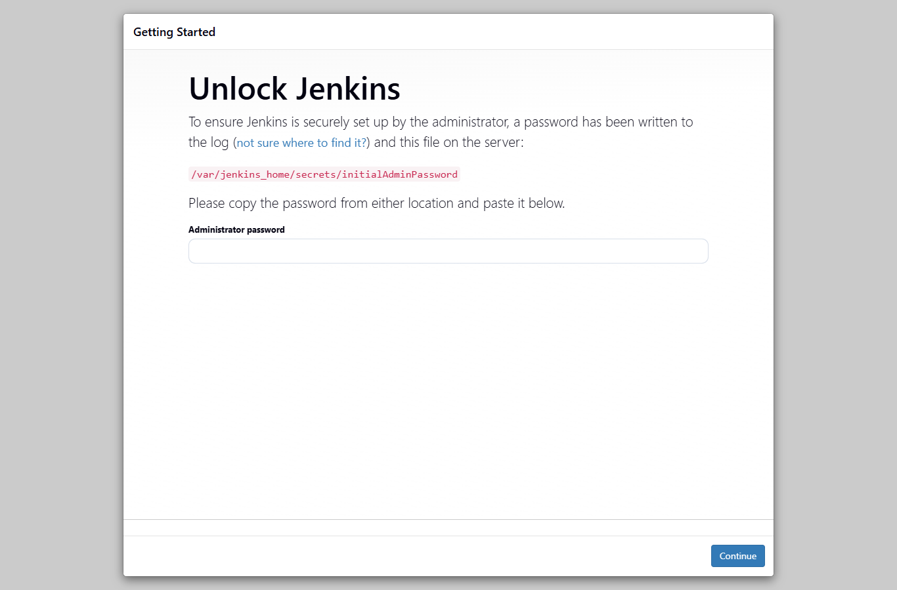
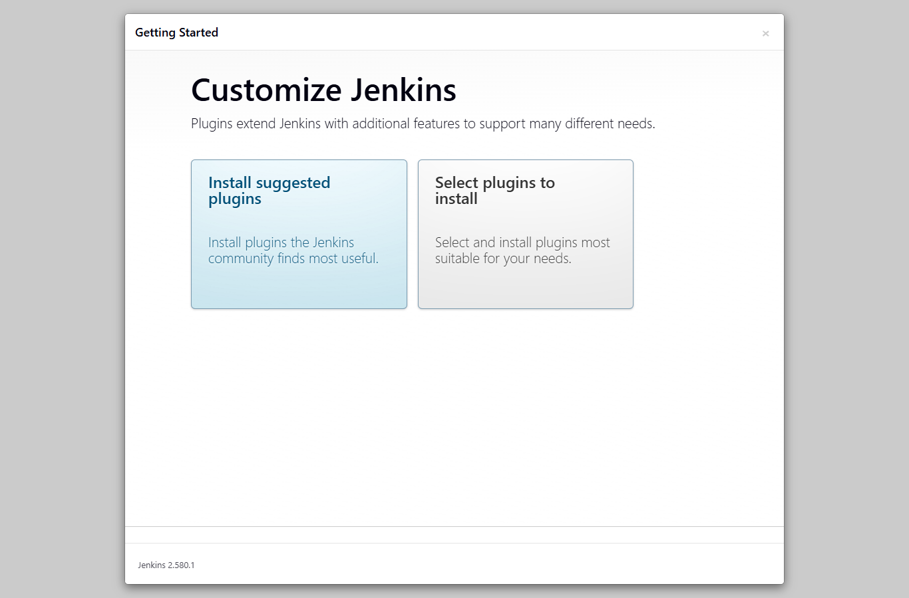
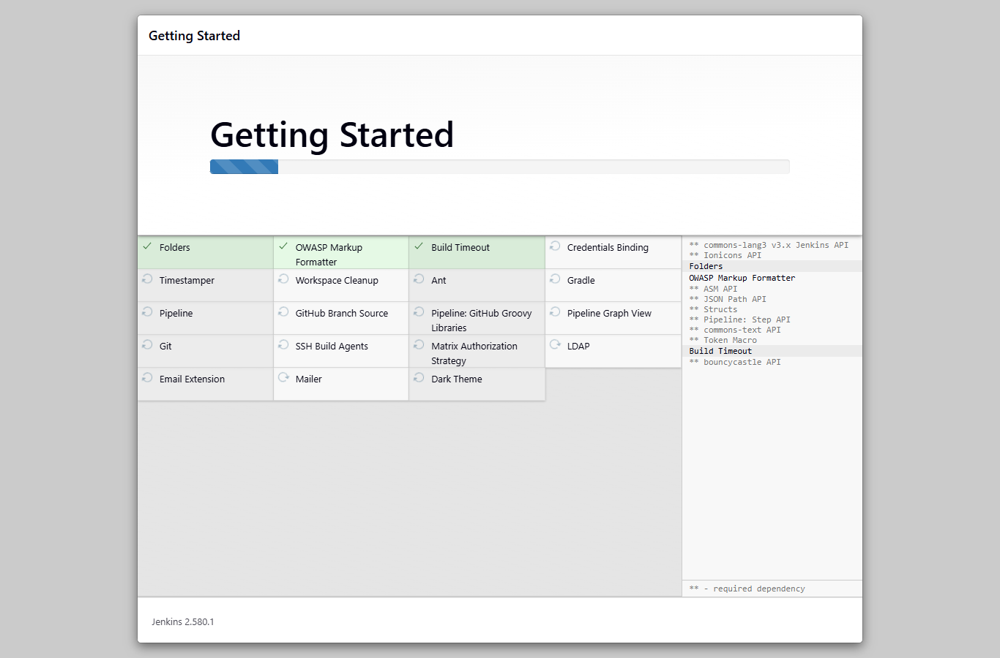
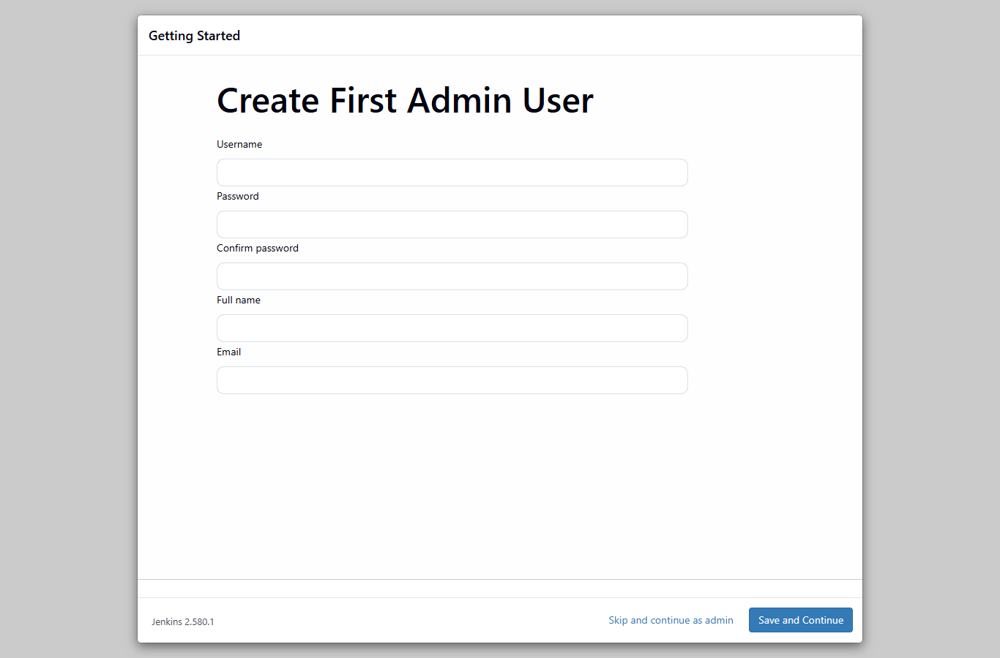
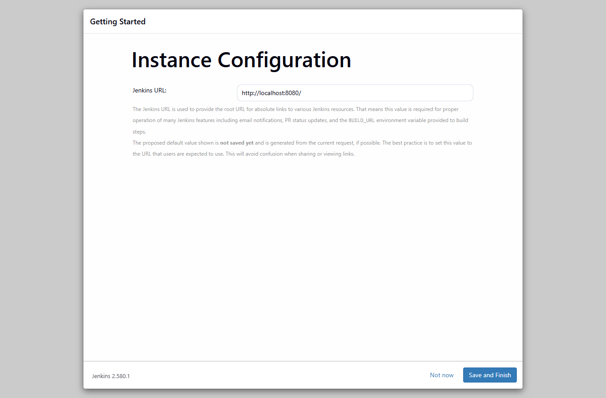
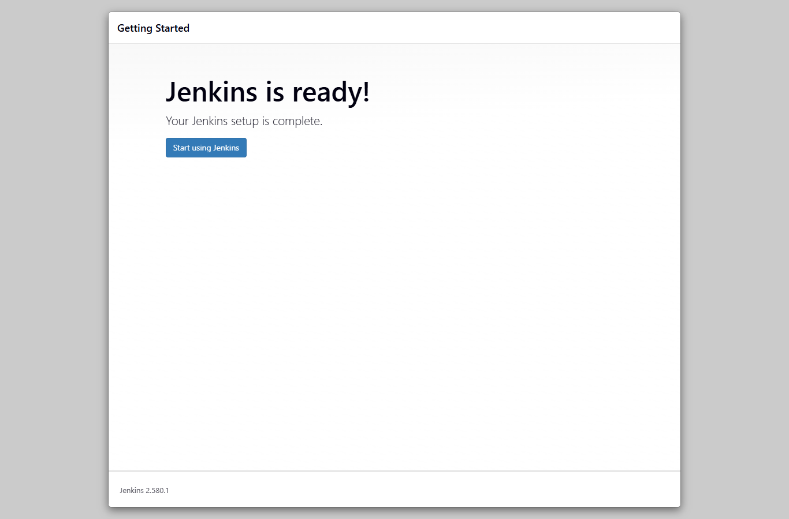
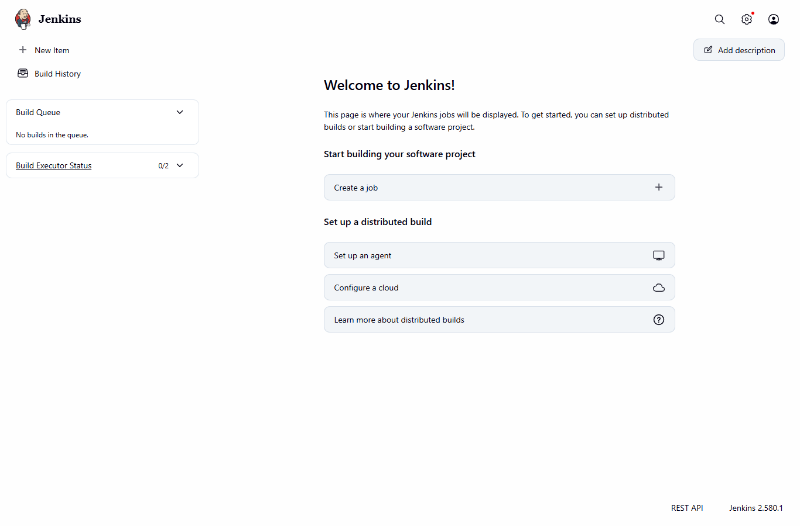

# Exercise 7 - Introduction to CI and Jenkins Installation

## Aim
To understand Continuous Integration (CI) and to install Jenkins using Docker, unlock it with the initial admin password and complete the setup.

## Theory (short)
- **Continuous Integration (CI)** - developers push code to a shared repo often, and every push is built and tested automatically so errors are found early.
- **CI flow** - code change -> CI server detects the push -> build -> run tests -> feedback to developer.
- **CI tools** - Jenkins, GitLab CI/CD, CircleCI, Travis CI, Bamboo, TeamCity, Azure Pipelines, GitHub Actions, Spinnaker, Buildkite, Drone.
- **Jenkins** - open source automation server used for CI/CD.
- **Jenkins terms** - Job/Project, Build, Pipeline, Plugins, Nodes (master/agent).

## Files
| File | Use |
|------|-----|
| `commands.ps1` | all commands used in this exercise |
| `jenkins-unlock.png` | Unlock Jenkins screen |
| `jenkins-customize.png` | Customize Jenkins (plugins) screen |
| `jenkins-getting-started.png` | suggested plugins getting installed |
| `jenkins-create-admin.png` | Create First Admin User screen |
| `jenkins-instance-config.png` | Instance Configuration screen |
| `jenkins-ready.png` | Jenkins is ready screen |
| `jenkins-landing-page.png` | Jenkins dashboard after setup |

## Procedure

1. Install Jenkins using Docker (external access is on port 8080)
   ```
   docker run -d --name jenkins -p 8080:8080 -p 50000:50000 jenkins/jenkins:lts
   ```
2. Check the container and get the initial admin password
   ```
   docker ps -a
   docker exec jenkins cat /var/jenkins_home/secrets/initialAdminPassword
   ```
   The password is also printed in `docker logs jenkins`.
3. Open `http://localhost:8080/` in the browser and paste the password in **Unlock Jenkins**, then click Continue.
4. Click **Install suggested plugins** and wait for the plugins to install.
5. Create the first admin user (username `admin`), then Save and Continue.
6. Keep the Jenkins URL as `http://localhost:8080/` and click Save and Finish.
7. Click **Start using Jenkins** to open the dashboard.

## Output

**Step 1 - docker run**
```
PS> docker run -d --name jenkins -p 8080:8080 -p 50000:50000 jenkins/jenkins:lts
b563ade15b6d015204faaa54d4e5a434d9b0d426c4f966eb7c46ef745bb49aae
```
There was no "Pulling from jenkins/jenkins" part because the `jenkins/jenkins:lts` image was already on my laptop from exercise 6:
```
PS> docker images jenkins/jenkins
IMAGE                 ID             DISK USAGE   CONTENT SIZE   EXTRA
jenkins/jenkins:lts   a660310e39ad        720MB          246MB   U
```

**Step 2 - container status and initial password**
```
PS> docker ps -a
CONTAINER ID   IMAGE                                 COMMAND                  CREATED          STATUS          PORTS                                                                                                                                  NAMES
b563ade15b6d   jenkins/jenkins:lts                   "/usr/bin/tini -- /u…"   33 seconds ago   Up 32 seconds   0.0.0.0:8080->8080/tcp, [::]:8080->8080/tcp, 0.0.0.0:50000->50000/tcp, [::]:50000->50000/tcp                                           jenkins
b5ab6296b95b   gcr.io/k8s-minikube/kicbase:v0.0.50   "/usr/local/bin/entr…"   13 hours ago     Up 13 hours     127.0.0.1:59312->22/tcp, 127.0.0.1:59310->2376/tcp, 127.0.0.1:59313->5000/tcp, 127.0.0.1:59314->8443/tcp, 127.0.0.1:59311->32443/tcp   minikube

PS> docker exec jenkins cat /var/jenkins_home/secrets/initialAdminPassword
8e989cc333d2466c84753c195542eaa9
```
Same password in the Jenkins log:
```
PS> docker logs jenkins
...
[LF]> *************************************************************
[LF]> 
[LF]> Jenkins initial setup is required. An admin user has been created and a password generated.
[LF]> Please use the following password to proceed to installation:
[LF]> 
[LF]> 8e989cc333d2466c84753c195542eaa9
[LF]> 
[LF]> This may also be found at: /var/jenkins_home/secrets/initialAdminPassword
[LF]> 
[LF]> *************************************************************
...
2026-10-21 07:10:50.648+0000 [id=55]	INFO	hudson.lifecycle.Lifecycle#onReady: Jenkins is fully up and running
```

**Step 3 to 7 - installation screens**

Unlock Jenkins



Customize Jenkins



Getting Started - installing suggested plugins



Create First Admin User



Instance Configuration



Jenkins is ready



Jenkins landing page



**Checking Jenkins after setup**
```
PS> curl.exe -s -I -u admin:admin123 http://localhost:8080/ | Select-String "X-Jenkins:"

X-Jenkins: 2.580.1

PS> (curl.exe -s -u admin:admin123 "http://localhost:8080/pluginManager/api/json?depth=1" | ConvertFrom-Json).plugins.Count
92
```

## Observations
- The teacher used `docker exec -it <id> bash` and then `cat`. I ran `docker exec jenkins cat ...` directly, it gives the same password without opening a shell.
- The initial admin password is printed in the container log and is also saved in `/var/jenkins_home/secrets/initialAdminPassword`.
- "Install suggested plugins" installed the common plugins (Folders, Pipeline, Git, Credentials Binding, etc). After setup Jenkins had 92 plugins (including dependencies).
- Jenkins version is 2.580.1. Port 8080 is for the web UI and port 50000 is for agents.
- The admin password `admin123` is only a lab password for a local container.

## Result
Jenkins was installed using Docker, unlocked with the initial admin password, the suggested plugins were installed, an admin user was created and the Jenkins dashboard was opened at `http://localhost:8080/`.

## Cleanup
The Jenkins container is kept running because exercise 8 uses the same Jenkins. To remove it later:
```
docker rm -f jenkins
```
