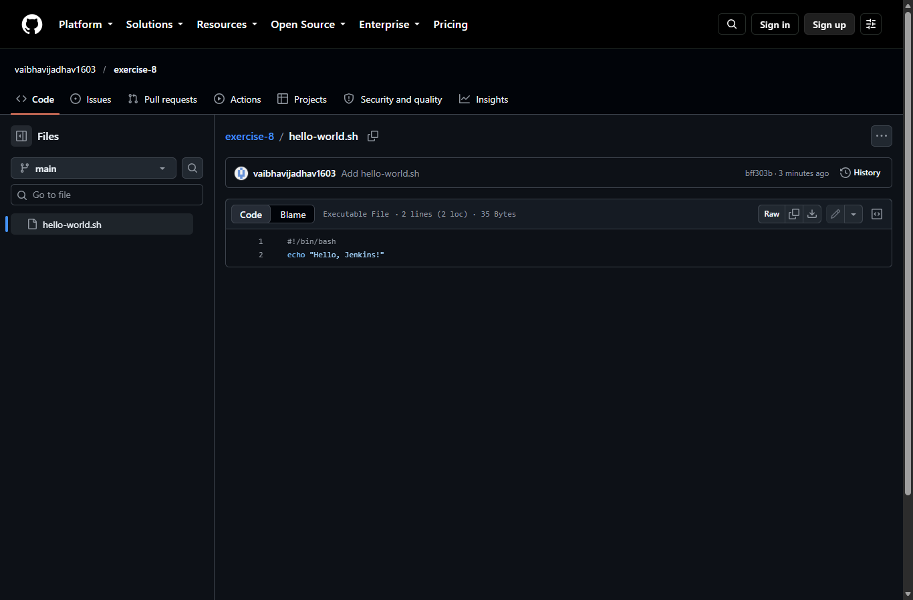
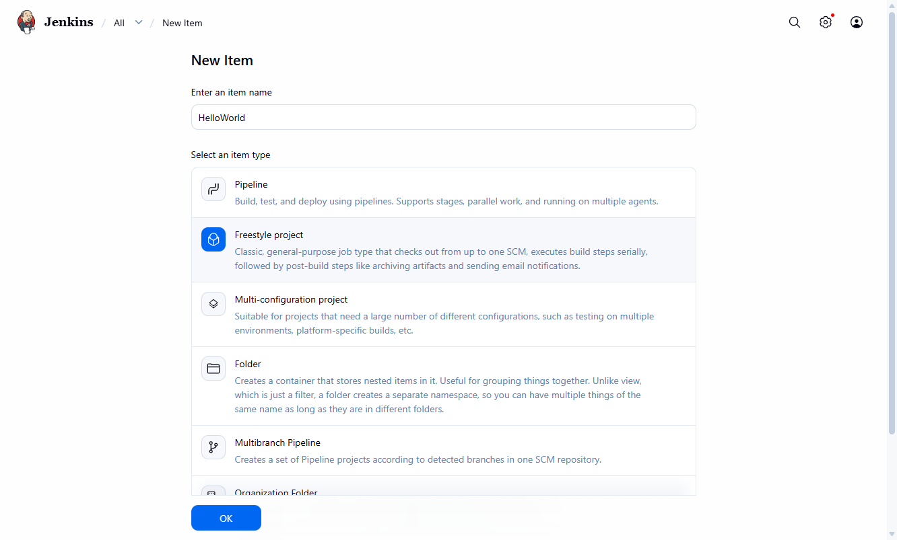
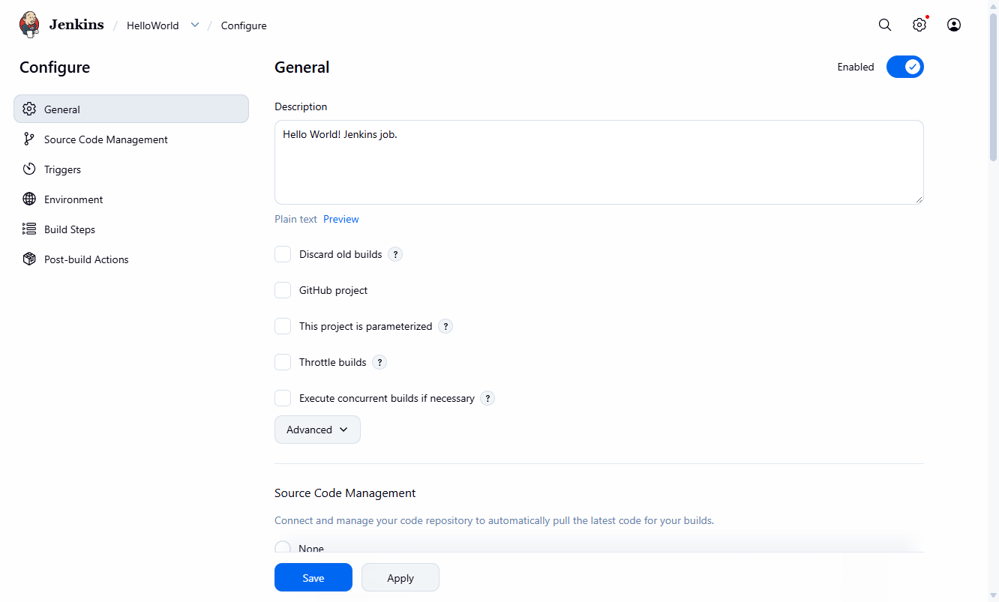
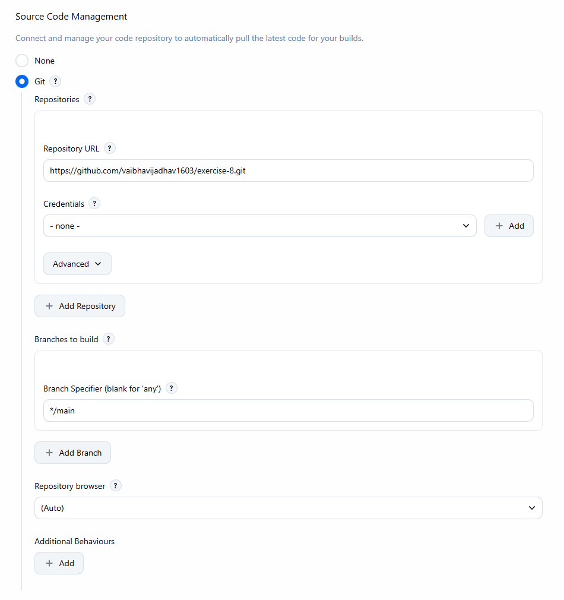
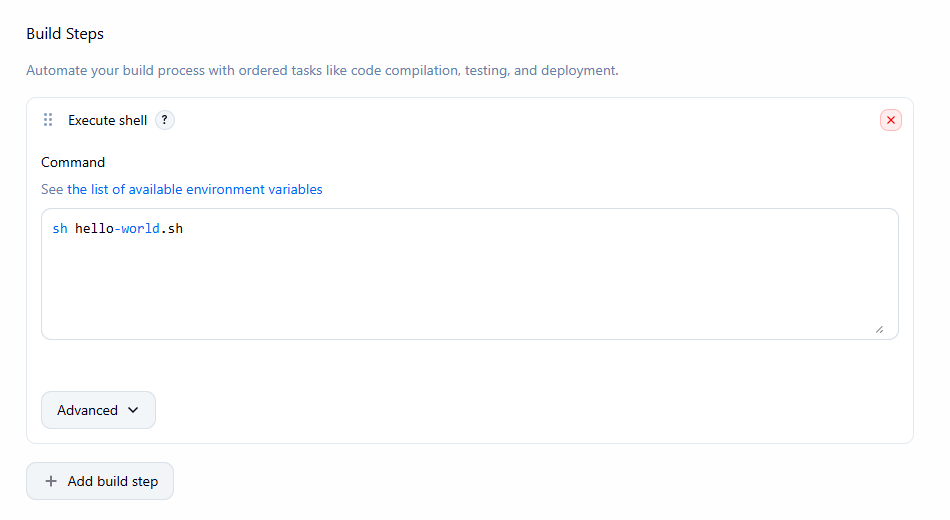
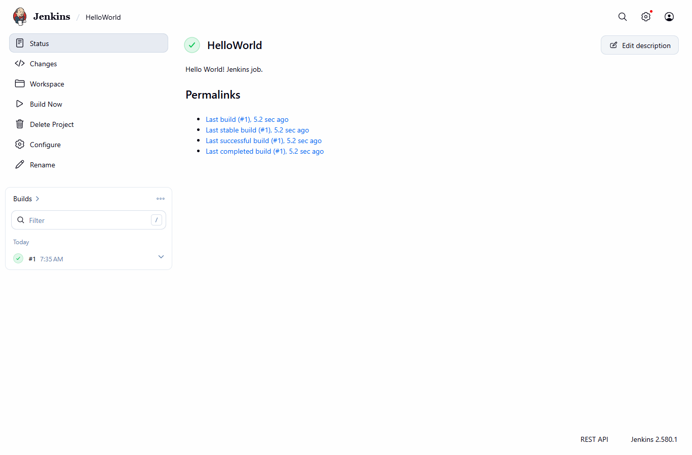
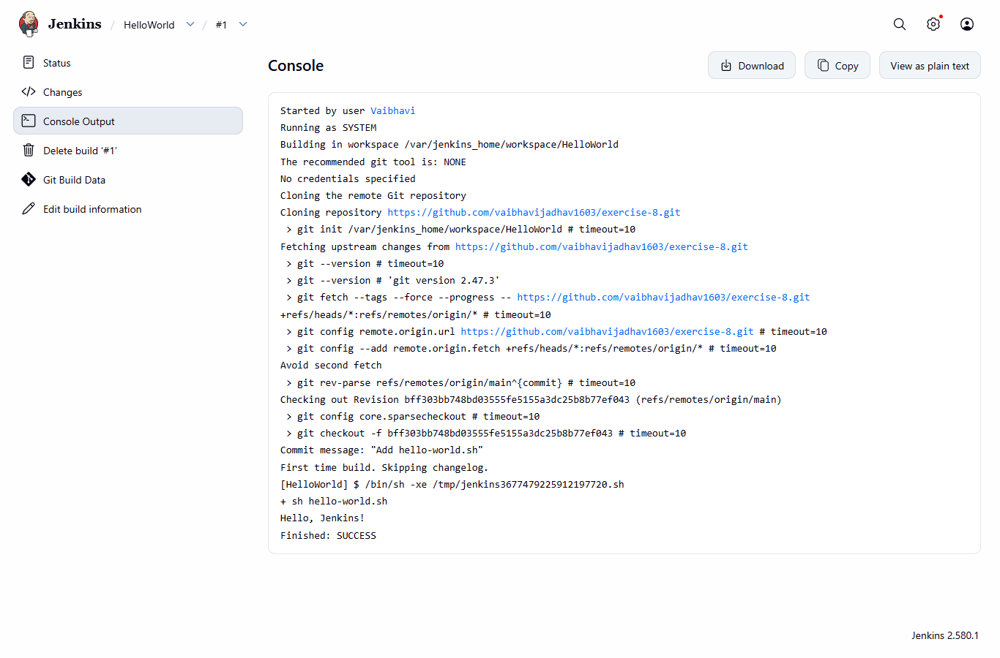

# Exercise 8 - Creating "Hello World" Jenkins Job

## Aim
To create a hello-world.sh script, push it to a GitHub repo and run it from a Jenkins Freestyle job.

## Files
- hello-world.sh - the script (same file I pushed to the exercise-8 repo)
- HelloWorld-config.xml - config of my Jenkins job, saved from Jenkins after I made it
- commands.ps1 - all the commands I used
- screenshots (.png) - GitHub and Jenkins screens

GitHub repo for the script: https://github.com/vaibhavijadhav1603/exercise-8

## Procedure

### Part 1 - script on GitHub

1. I made a new public repo called `exercise-8` with description "A demo repository for Jenkins scripting." (I named it exercise-8 instead of devops-sample-code). I made it from the terminal using gh since I am already logged in to gh.
   ```
   gh repo create exercise-8 --public --description "A demo repository for Jenkins scripting."
   ```
2. Made a folder `exercise-8`, created the script and made it executable
   ```
   touch hello-world.sh
   chmod +x hello-world.sh
   ```
   hello-world.sh:
   ```
   #!/bin/bash
   echo "Hello, Jenkins!"
   ```
3. Made it a git repo, added the file and committed
   ```
   git init
   git config user.name "Vaibhavi"
   git config user.email "vaibhavijadhav1603@gmail.com"
   git add hello-world.sh
   git status
   git commit -m "Add hello-world.sh"
   ```
4. Linked it to GitHub and pushed
   ```
   git remote add origin https://github.com/vaibhavijadhav1603/exercise-8.git
   git push -u origin main
   ```
5. Opened the repo on GitHub and checked hello-world.sh is there.

### Part 2 - Jenkins job

Jenkins was already running from exercise 7 (http://localhost:8080), I logged in as admin.

1. New Item -> name `HelloWorld` -> Freestyle project -> OK
2. Description: `Hello World! Jenkins job.`
3. Source Code Management -> Git -> Repository URL `https://github.com/vaibhavijadhav1603/exercise-8.git`. I changed Branch Specifier from `*/master` to `*/main` because my repo branch is main.
4. Build Steps -> Add build step -> Execute shell -> `sh hello-world.sh`
5. Save, then Build Now
6. Build History -> #1 -> Console Output

## Output

git status before commit:
```
$ git init
Initialized empty Git repository in C:/Users/vaibh/exercise-8/.git/
$ git add hello-world.sh
$ git status
On branch main

No commits yet

Changes to be committed:
  (use "git rm --cached <file>..." to unstage)
	new file:   hello-world.sh

```

commit:
```
$ git commit -m "Add hello-world.sh"
[main (root-commit) bff303b] Add hello-world.sh
 1 file changed, 2 insertions(+)
 create mode 100755 hello-world.sh
```

push:
```
$ git remote add origin https://github.com/vaibhavijadhav1603/exercise-8.git
$ git push -u origin main
branch 'main' set up to track 'origin/main'.
To https://github.com/vaibhavijadhav1603/exercise-8.git
 * [new branch]      main -> main

$ git ls-remote origin main
bff303bb748bd03555fe5155a3dc25b8b77ef043	refs/heads/main
```

Script on GitHub:



New Item - Freestyle project:



Job config - description:



Job config - Git repo and branch:



Job config - Execute shell:



Job page after the build:



Console Output of build #1:



Same console output as text:
```
Started by user Vaibhavi
Running as SYSTEM
Building in workspace /var/jenkins_home/workspace/HelloWorld
The recommended git tool is: NONE
No credentials specified
Cloning the remote Git repository
Cloning repository https://github.com/vaibhavijadhav1603/exercise-8.git
 > git init /var/jenkins_home/workspace/HelloWorld # timeout=10
Fetching upstream changes from https://github.com/vaibhavijadhav1603/exercise-8.git
 > git --version # timeout=10
 > git --version # 'git version 2.47.3'
 > git fetch --tags --force --progress -- https://github.com/vaibhavijadhav1603/exercise-8.git +refs/heads/*:refs/remotes/origin/* # timeout=10
 > git config remote.origin.url https://github.com/vaibhavijadhav1603/exercise-8.git # timeout=10
 > git config --add remote.origin.fetch +refs/heads/*:refs/remotes/origin/* # timeout=10
Avoid second fetch
 > git rev-parse refs/remotes/origin/main^{commit} # timeout=10
Checking out Revision bff303bb748bd03555fe5155a3dc25b8b77ef043 (refs/remotes/origin/main)
 > git config core.sparsecheckout # timeout=10
 > git checkout -f bff303bb748bd03555fe5155a3dc25b8b77ef043 # timeout=10
Commit message: "Add hello-world.sh"
First time build. Skipping changelog.
[HelloWorld] $ /bin/sh -xe /tmp/jenkins3677479225912197720.sh
+ sh hello-world.sh
Hello, Jenkins!
Finished: SUCCESS
```

## Observations
- Jenkins cloned my exercise-8 repo into its workspace and ran the script, it printed `Hello, Jenkins!` and the build was SUCCESS.
- The default branch in Jenkins is `*/master`, my repo uses `main` so I had to change it or the build would not find the branch.
- I used `git config` without `--global` so the name and email are set only for this repo.
- git push did not ask for username and PAT because gh was already logged in on my laptop and it gives the login to git.
- The repo is public so Jenkins did not need any credentials to clone it.
- In the teacher's output it says `On branch master` but mine says `main`, because my git makes main as the default branch.

## Result
I created hello-world.sh, pushed it to my GitHub repo exercise-8 using git, and made a Jenkins Freestyle job HelloWorld that pulled the script from GitHub and ran it. Build #1 printed "Hello, Jenkins!" and finished with SUCCESS.

## Cleanup
Jenkins is still running for exercise 9. To stop it later:
```
docker rm -f jenkins
```
