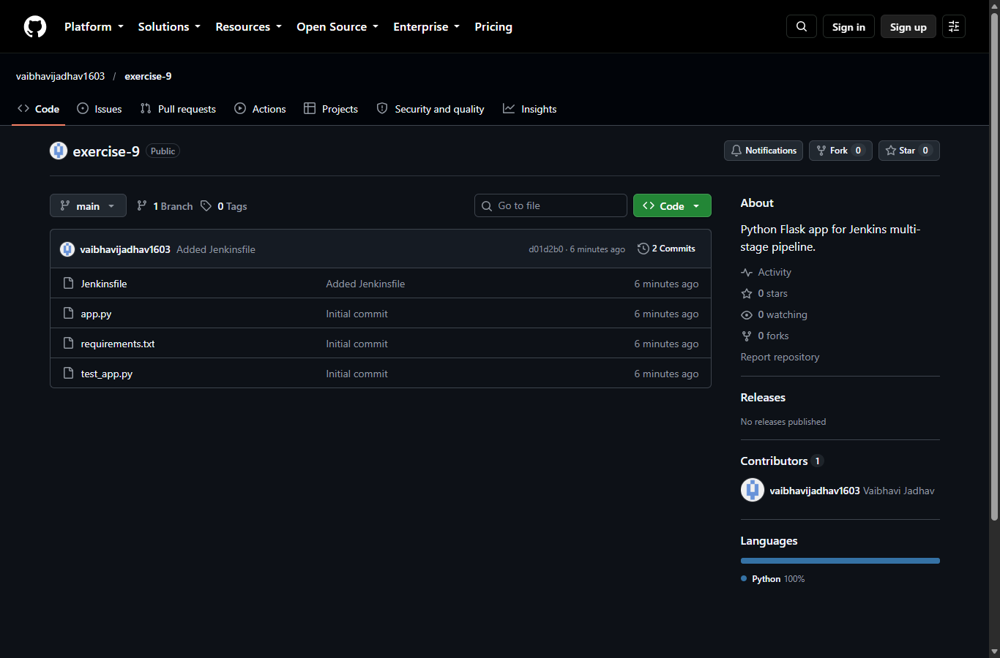
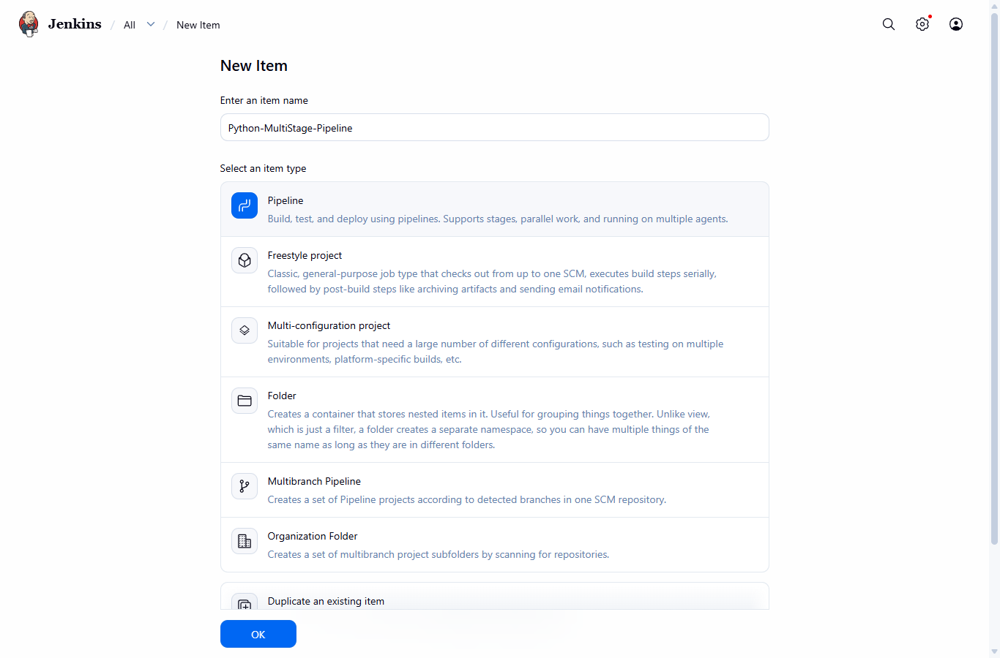
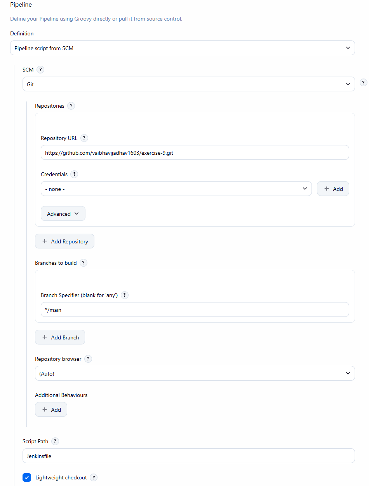
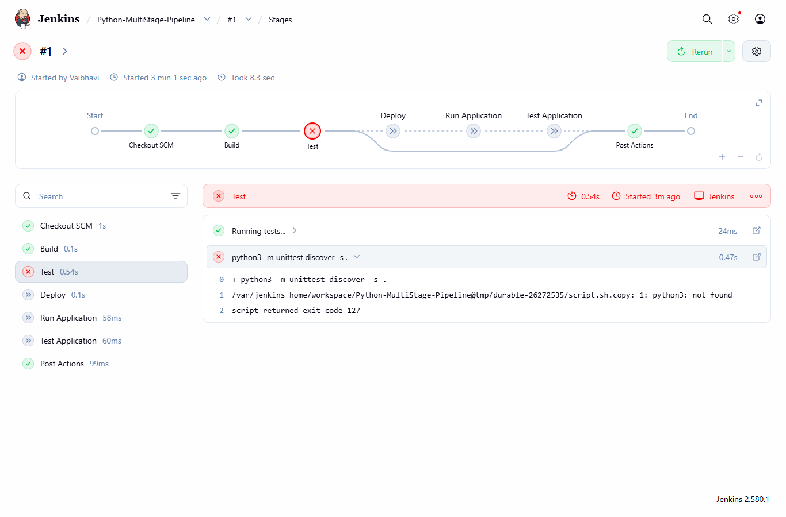
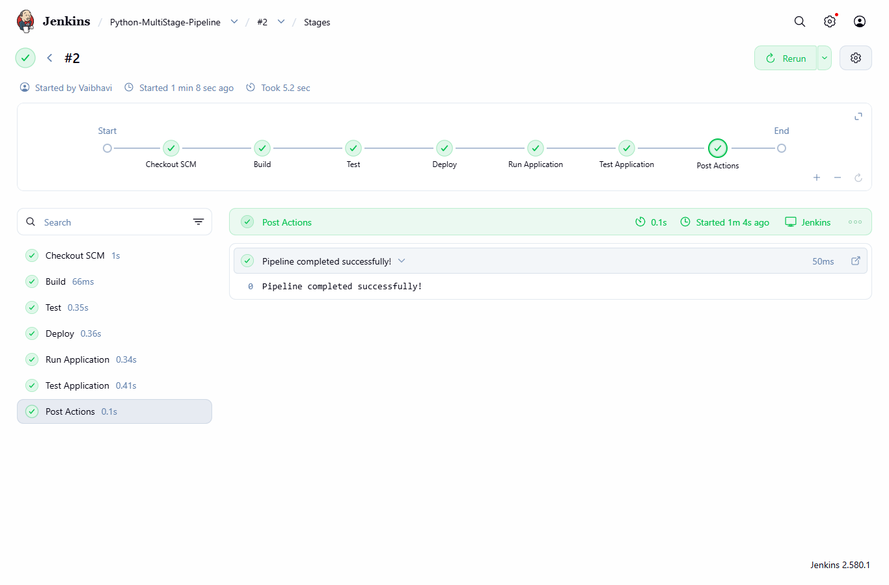
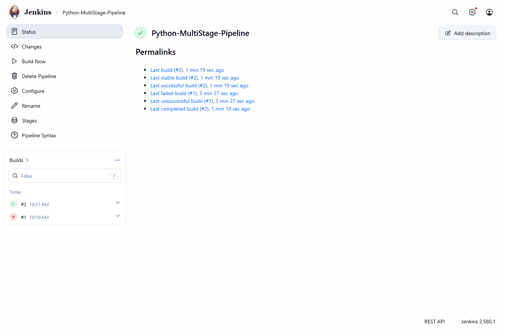

# Exercise 9 - Jenkins Multi-Stage Pipeline (Python Flask app)

## Aim
To make a Jenkins Pipeline with Build, Test, Deploy, Run Application and Test Application stages for a small Python Flask app, taking the Jenkinsfile from GitHub.

## Files
- app.py - Flask app, returns "Hello, Jenkins Multi-Stage Pipeline!"
- requirements.txt - flask==2.1.2
- test_app.py - unittest for the home page
- Jenkinsfile - the multi-stage pipeline
- Python-MultiStage-Pipeline-config.xml - config of my Jenkins pipeline job, saved from Jenkins
- commands.ps1 - all the commands I used
- screenshots (.png)

GitHub repo for the app: https://github.com/vaibhavijadhav1603/exercise-9 (I named it exercise-9 instead of devops-sample-code, the local folder is python-flask-app like in the exercise)

## Procedure

1. Jenkins was already running from exercise 7. Pipeline plugin was already there from "Install suggested plugins" (workflow-aggregator 608.v67378e9d3db_1).
2. Made the folder `python-flask-app` and created app.py, requirements.txt and test_app.py (same code as the exercise).
3. Made the GitHub repo `exercise-9` (with gh) and pushed the code:
   ```
   git init
   git add .
   git commit -m "Initial commit"
   git remote add origin https://github.com/vaibhavijadhav1603/exercise-9.git
   git push -u origin main
   ```
4. In Jenkins: New Item -> `Python-MultiStage-Pipeline` -> Pipeline -> OK
5. Created the Jenkinsfile (same as the exercise) and pushed it:
   ```
   git add Jenkinsfile
   git commit -m "Added Jenkinsfile"
   git push
   ```
6. In the job config: Pipeline -> Definition `Pipeline script from SCM` -> SCM `Git` -> repo URL `https://github.com/vaibhavijadhav1603/exercise-9.git`. Changed branch from `*/master` to `*/main`. Script Path `Jenkinsfile`. No credentials since the repo is public. Save.
7. Build Now -> build #1 failed in the Test stage because python3 is not there in the Jenkins container.
8. Fixed it by installing python inside the Jenkins container as root (Step 8 of exercise), then Build Now again -> build #2 SUCCESS.

## Output

git push (Step 3 and 5):
```
$ git init
Initialized empty Git repository in C:/Users/vaibh/python-flask-app/.git/
$ git add .
$ git commit -m "Initial commit"
[main (root-commit) 042bb9b] Initial commit
 3 files changed, 24 insertions(+)
 create mode 100644 app.py
 create mode 100644 requirements.txt
 create mode 100644 test_app.py
$ git remote add origin https://github.com/vaibhavijadhav1603/exercise-9.git
$ git push -u origin main
branch 'main' set up to track 'origin/main'.
To https://github.com/vaibhavijadhav1603/exercise-9.git
 * [new branch]      main -> main
```
```
$ git add Jenkinsfile
$ git commit -m "Added Jenkinsfile"
[main d01d2b0] Added Jenkinsfile
 1 file changed, 52 insertions(+)
 create mode 100644 Jenkinsfile
$ git push
To https://github.com/vaibhavijadhav1603/exercise-9.git
   042bb9b..d01d2b0  main -> main
```

Repo on GitHub:



New Item - Pipeline:



Pipeline config (script from SCM):



### Build #1 - FAILED



Console output (the git checkout part is cut):
```
Started by user Vaibhavi
Obtained Jenkinsfile from git https://github.com/vaibhavijadhav1603/exercise-9.git
[Pipeline] Start of Pipeline
[Pipeline] node
Running on Jenkins in /var/jenkins_home/workspace/Python-MultiStage-Pipeline
...
Checking out Revision d01d2b06b56b85b444004021b3c3897fa37b80a8 (refs/remotes/origin/main)
Commit message: "Added Jenkinsfile"
First time build. Skipping changelog.
...
[Pipeline] { (Build)
[Pipeline] echo
Creating virtual environment and installing dependencies...
[Pipeline] }
[Pipeline] // stage
[Pipeline] stage
[Pipeline] { (Test)
[Pipeline] echo
Running tests...
[Pipeline] sh
+ python3 -m unittest discover -s .
/var/jenkins_home/workspace/Python-MultiStage-Pipeline@tmp/durable-26272535/script.sh.copy: 1: python3: not found
[Pipeline] }
[Pipeline] // stage
[Pipeline] stage
[Pipeline] { (Deploy)
Stage "Deploy" skipped due to earlier failure(s)
...
[Pipeline] { (Run Application)
Stage "Run Application" skipped due to earlier failure(s)
...
[Pipeline] { (Test Application)
Stage "Test Application" skipped due to earlier failure(s)
...
[Pipeline] { (Declarative: Post Actions)
[Pipeline] echo
Pipeline failed. Check the logs for more details.
...
[Pipeline] End of Pipeline
ERROR: script returned exit code 127
Finished: FAILURE
```

### Step 8 - fixing the error

```
PS> docker ps -a
CONTAINER ID   IMAGE                 COMMAND                  CREATED       STATUS       PORTS                                                                                          NAMES
b563ade15b6d   jenkins/jenkins:lts   "/usr/bin/tini -- /u…"   3 hours ago   Up 3 hours   0.0.0.0:8080->8080/tcp, [::]:8080->8080/tcp, 0.0.0.0:50000->50000/tcp, [::]:50000->50000/tcp   jenkins

PS> docker exec -u root jenkins bash -c "cat /etc/os-release | head -2; whoami"
PRETTY_NAME="Debian GNU/Linux 13 (trixie)"
NAME="Debian GNU/Linux"
root
```

apt commands inside the container (only the main lines, the download and unpacking lines are removed):
```
### apt-get update
Fetched 10.2 MB in 3s (3693 kB/s)
exit code: 0
### apt install -y python3
Fetched 6149 kB in 1s (11.1 MB/s)
Setting up python3 (3.13.5-1) ...
exit code: 0
### apt install -y pip
Fetched 95.9 MB in 5s (18.9 MB/s)
Setting up python3-pip (25.1.1+dfsg-1) ...
exit code: 0
### apt install -y python3.11-venv
Error: Unable to locate package python3.11-venv
exit code: 100
### apt install -y python3-flask
Fetched 8119 kB in 1s (13.4 MB/s)
Setting up python3-flask (3.1.1-1+deb13u1) ...
exit code: 0
```
python3.11-venv is not there because this Jenkins image is Debian 13 which has python 3.13. So I installed python3-venv:
```
### apt install -y python3-venv
Setting up python3.13-venv (3.13.5-2+deb13u5) ...
Setting up python3-venv (3.13.5-1) ...
exit code: 0
```
Checking versions and running the test inside the workspace:
```
Python 3.13.5
pip 25.1.1 from /usr/lib/python3/dist-packages/pip (python 3.13)
flask 3.1.1
### python3 -m unittest discover -s .
Hello, Jenkins Multi-Stage Pipeline!
.
----------------------------------------------------------------------
Ran 1 test in 0.004s

OK
```

### Build #2 - SUCCESS



Console output:
```
Started by user Vaibhavi
Obtained Jenkinsfile from git https://github.com/vaibhavijadhav1603/exercise-9.git
[Pipeline] Start of Pipeline
[Pipeline] node
Running on Jenkins in /var/jenkins_home/workspace/Python-MultiStage-Pipeline
[Pipeline] {
[Pipeline] stage
[Pipeline] { (Declarative: Checkout SCM)
[Pipeline] checkout
Selected Git installation does not exist. Using Default
The recommended git tool is: NONE
No credentials specified
 > git rev-parse --resolve-git-dir /var/jenkins_home/workspace/Python-MultiStage-Pipeline/.git # timeout=10
Fetching changes from the remote Git repository
 > git config remote.origin.url https://github.com/vaibhavijadhav1603/exercise-9.git # timeout=10
Fetching upstream changes from https://github.com/vaibhavijadhav1603/exercise-9.git
 > git --version # timeout=10
 > git --version # 'git version 2.47.3'
 > git fetch --tags --force --progress -- https://github.com/vaibhavijadhav1603/exercise-9.git +refs/heads/*:refs/remotes/origin/* # timeout=10
 > git rev-parse refs/remotes/origin/main^{commit} # timeout=10
Checking out Revision d01d2b06b56b85b444004021b3c3897fa37b80a8 (refs/remotes/origin/main)
 > git config core.sparsecheckout # timeout=10
 > git checkout -f d01d2b06b56b85b444004021b3c3897fa37b80a8 # timeout=10
Commit message: "Added Jenkinsfile"
 > git rev-list --no-walk d01d2b06b56b85b444004021b3c3897fa37b80a8 # timeout=10
[Pipeline] }
[Pipeline] // stage
[Pipeline] withEnv
[Pipeline] {
[Pipeline] stage
[Pipeline] { (Build)
[Pipeline] echo
Creating virtual environment and installing dependencies...
[Pipeline] }
[Pipeline] // stage
[Pipeline] stage
[Pipeline] { (Test)
[Pipeline] echo
Running tests...
[Pipeline] sh
+ python3 -m unittest discover -s .
.
----------------------------------------------------------------------
Ran 1 test in 0.005s

OK
Hello, Jenkins Multi-Stage Pipeline!
[Pipeline] }
[Pipeline] // stage
[Pipeline] stage
[Pipeline] { (Deploy)
[Pipeline] echo
Deploying application...
[Pipeline] sh
+ mkdir -p /var/jenkins_home/workspace/Python-MultiStage-Pipeline/python-app-deploy
+ cp /var/jenkins_home/workspace/Python-MultiStage-Pipeline/app.py /var/jenkins_home/workspace/Python-MultiStage-Pipeline/python-app-deploy/
[Pipeline] }
[Pipeline] // stage
[Pipeline] stage
[Pipeline] { (Run Application)
[Pipeline] echo
Running application...
[Pipeline] sh
+ echo 2381
+ nohup python3 /var/jenkins_home/workspace/Python-MultiStage-Pipeline/python-app-deploy/app.py
[Pipeline] }
[Pipeline] // stage
[Pipeline] stage
[Pipeline] { (Test Application)
[Pipeline] echo
Testing application...
[Pipeline] sh
+ python3 /var/jenkins_home/workspace/Python-MultiStage-Pipeline/test_app.py
.
----------------------------------------------------------------------
Ran 1 test in 0.004s

OK
Hello, Jenkins Multi-Stage Pipeline!
[Pipeline] }
[Pipeline] // stage
[Pipeline] stage
[Pipeline] { (Declarative: Post Actions)
[Pipeline] echo
Pipeline completed successfully!
[Pipeline] }
[Pipeline] // stage
[Pipeline] }
[Pipeline] // withEnv
[Pipeline] }
[Pipeline] // node
[Pipeline] End of Pipeline
Finished: SUCCESS
```

Job page with both builds:



Deploy folder after build #2 (colour codes from the flask log removed):
```
$ docker exec jenkins bash -c 'cd /var/jenkins_home/workspace/Python-MultiStage-Pipeline && ls python-app-deploy && echo "### app.pid" && cat python-app-deploy/app.pid && echo "### app.log" && cat python-app-deploy/app.log'
app.log
app.pid
app.py
### app.pid
2381
### app.log
 * Serving Flask app 'app'
 * Debug mode: on
WARNING: This is a development server. Do not use it in a production deployment. Use a production WSGI server instead.
 * Running on http://127.0.0.1:5000
Press CTRL+C to quit
 * Restarting with stat
 * Debugger is active!
 * Debugger PIN: 878-774-862
```
Checking if the app is still running after the build:
```
$ docker exec jenkins ps -eo pid,args
    PID COMMAND
      1 /usr/bin/tini -- /usr/local/bin/jenkins.sh
      7 java -Duser.home=/var/jenkins_home -Djenkins.model.Jenkins.slaveAgentPort=50000 -Dhudson.lifecycle=hudson.lifecycle.ExitLifecycle -jar /usr/share/jenkins/jenkins.war
   2422 ps -eo pid,args

$ docker exec jenkins curl -s -m 3 http://127.0.0.1:5000/; echo "curl exit code: $?"
curl exit code: 7
```

## Observations
- Build #1 failed in the Test stage with `python3: not found` (exit code 127). The jenkins/jenkins:lts image does not have python. Because Test failed, Deploy, Run Application and Test Application were skipped, and the post `failure` message was printed.
- After installing python3, pip, python3-venv and python3-flask inside the container, build #2 passed all the stages and printed "Pipeline completed successfully!".
- `python3.11-venv` from the exercise is not available on this Jenkins image (Debian 13, python 3.13), so I used `python3-venv`.
- The teacher used `docker exec -it -u root <container-id> bash` and typed the commands inside. I ran the same commands with `docker exec -u root jenkins ...` from PowerShell, and added `-y` to apt so it does not ask yes/no.
- The Build stage only prints a message, it does not run `pip install -r requirements.txt`. Flask came from `python3-flask` (3.1.1), not flask 2.1.2 from requirements.txt.
- The app was deployed to `${WORKSPACE}/python-app-deploy` (not /tmp like it says in Expected Outcome).
- In Run Application the app started (app.log shows it running on 127.0.0.1:5000), but after the build `ps` shows only Jenkins (no python process, PID 2381 is gone) and curl failed. Jenkins stops the background processes started in a step when the step ends.
- The Test Application stage uses Flask's test client, so it passes even when the app is not running.
- Branch had to be changed to `*/main` in Jenkins because my repo uses main.
- I installed the packages manually inside the container, so if the Jenkins container is deleted they have to be installed again.

## Result
I pushed the Flask app and Jenkinsfile to GitHub and made a Jenkins Pipeline job that takes the Jenkinsfile from the repo. The first build failed because python3 was missing. After installing python in the Jenkins container, the pipeline ran all the stages (Build, Test, Deploy, Run Application, Test Application) and finished with SUCCESS.

## Cleanup
Jenkins is kept running till I finish the Jenkins exercises. To remove it:
```
docker rm -f jenkins
```
