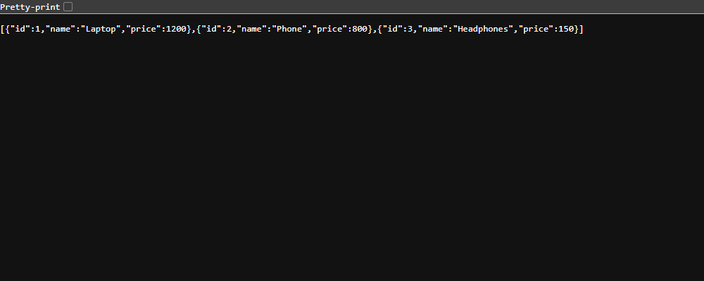
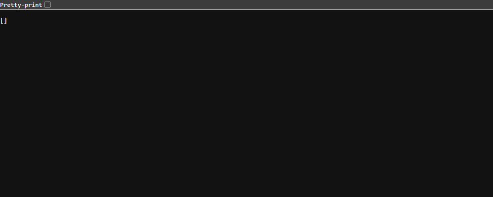

# Exercise 10 - Multi-Node Kubernetes Cluster with Multiple Applications and ReplicaSets

## Aim
To create a 3 node minikube cluster and deploy two Flask apps, Product Catalog (2 replicas) and
Shopping Cart (3 replicas), with the replicas spread across different nodes, and access them using
NodePort services.

## Files
- `product_catalog.py` - Flask app, `GET /products` returns the product list (port 80)
- `shopping_cart.py` - Flask app, `GET /cart` and `POST /cart` (port 80)
- `Dockerfile.product` - image for product catalog (python:3.9-slim)
- `Dockerfile.shopping` - image for shopping cart (python:3.9-slim)
- `product_catalog_deployment.yaml` - Deployment with 2 replicas and podAntiAffinity
- `shopping_cart_deployment.yaml` - Deployment with 3 replicas and podAntiAffinity
- `product_catalog_service.yaml` - NodePort service for product catalog
- `shopping_cart_service.yaml` - NodePort service for shopping cart
- `commands.ps1` - all the commands I used
- `product-catalog-products.png`, `shopping-cart-cart.png` - screenshots of the two apps in the browser

Notes:
- In the exercise `shopping_cart_deployment.yaml` has `namespace: devops-exercise`. That namespace does
  not exist, so the apply failed (output in Step 6). The service is in `default` and the expected output
  shows all pods in `default`, so I changed it to `namespace: default`. The file here is the changed one.
- I ran everything in PowerShell on Windows, not in a Linux/WSL terminal.
- The tunnel ports (55118, 55119) change every time `minikube service` is run.

## Software used
- Windows 11 (PowerShell)
- Docker Desktop 29.8.2
- minikube v1.38.1 (docker driver), Kubernetes v1.35.1
- kubectl v1.36.4

## Procedure
1. Delete the old minikube cluster (Step 0)
   ```powershell
   minikube stop
   minikube delete
   ```
2. Start a 3 node cluster and check the nodes (Step 1a)
   ```powershell
   minikube start --nodes 3 -p devops-multinode --force
   kubectl get nodes -o wide
   ```
3. Enable the registry addon (Step 1b)
   ```powershell
   minikube -p devops-multinode addons enable registry
   ```
4. Create `product_catalog.py` and `shopping_cart.py` (Step 2 and 3)
5. Create the two Dockerfiles and build the images (Step 4)
   ```powershell
   docker build -t product-catalog:latest -f Dockerfile.product .
   docker build -t shopping-cart:latest -f Dockerfile.shopping .
   docker images --filter reference=product-catalog --filter reference=shopping-cart
   ```
6. Load the images into minikube and check them (Step 5)
   ```powershell
   minikube -p devops-multinode image load product-catalog:latest
   minikube -p devops-multinode image load shopping-cart:latest
   minikube -p devops-multinode ssh -- docker images
   ```
   I also checked the other two nodes with `-n devops-multinode-m02` and `-n devops-multinode-m03`.
7. Apply the deployments (Step 6)
   ```powershell
   kubectl apply -f product_catalog_deployment.yaml
   kubectl apply -f shopping_cart_deployment.yaml
   ```
8. Apply the services (Step 7)
   ```powershell
   kubectl apply -f product_catalog_service.yaml
   kubectl apply -f shopping_cart_service.yaml
   ```
9. Check which node each pod is running on (Step 8)
   ```powershell
   kubectl get pods -o wide
   kubectl get deployments
   kubectl get services
   ```
10. Open the services, each in its own terminal and keep them open (Step 9)
    ```powershell
    minikube -p devops-multinode service product-catalog-service
    minikube -p devops-multinode service shopping-cart-service
    ```
11. Test with curl (Step 10)
    ```powershell
    curl.exe http://127.0.0.1:55118/products
    curl.exe http://127.0.0.1:55119/cart
    curl.exe -X POST http://127.0.0.1:55119/cart -H "Content-Type: application/json" -d '{\"id\": 1, \"name\": \"Laptop\", \"quantity\": 1}'
    ```
    In PowerShell the double quotes inside the JSON have to be written as `\"`.
12. Extra check: GET the cart a few times and look at the cart inside each pod
    ```powershell
    1..8 | ForEach-Object { "$_ : " + (curl.exe -s http://127.0.0.1:55119/cart) }
    foreach ($p in (kubectl get pods -l app=shopping-cart -o name)) { kubectl exec $p -- python -c "import urllib.request;print(urllib.request.urlopen('http://127.0.0.1/cart').read().decode())" }
    ```

## Output

**Step 0 - minikube stop / minikube delete**
```
✋  Stopping node "minikube"  ...
🛑  Powering off "minikube" via SSH ...
🛑  1 node stopped.
🔥  Deleting "minikube" in docker ...
🔥  Deleting container "minikube" ...
🔥  Removing C:\Users\vaibh\.minikube\machines\minikube ...
💀  Removed all traces of the "minikube" cluster.
```

**Step 1a - minikube start --nodes 3 -p devops-multinode --force**

(PowerShell printed the `❗` warning line as a NativeCommandError, I removed those extra error lines)
```
😄  [devops-multinode] minikube v1.38.1 on Microsoft Windows 11 Home Single Language 25H2
❗  minikube skips various validations when --force is supplied; this may lead to unexpected behavior
✨  Automatically selected the docker driver. Other choices: virtualbox, ssh
❗  Starting v1.39.0, minikube will default to "containerd" container runtime. See #21973 for more info.
📌  Using Docker Desktop driver with root privileges
👍  Starting "devops-multinode" primary control-plane node in "devops-multinode" cluster
🚜  Pulling base image v0.0.50 ...
🔗  Configuring CNI (Container Networking Interface) ...
🔎  Verifying Kubernetes components...
    ▪ Using image gcr.io/k8s-minikube/storage-provisioner:v5
🌟  Enabled addons: storage-provisioner, default-storageclass

👍  Starting "devops-multinode-m02" worker node in "devops-multinode" cluster
🚜  Pulling base image v0.0.50 ...
🌐  Found network options:
    ▪ NO_PROXY=192.168.49.2
    ▪ NO_PROXY=192.168.49.2
    ▪ env NO_PROXY=192.168.49.2
🔎  Verifying Kubernetes components...

👍  Starting "devops-multinode-m03" worker node in "devops-multinode" cluster
🚜  Pulling base image v0.0.50 ...
🌐  Found network options:
    ▪ NO_PROXY=192.168.49.2,192.168.49.3
    ▪ NO_PROXY=192.168.49.2,192.168.49.3
    ▪ env NO_PROXY=192.168.49.2
    ▪ env NO_PROXY=192.168.49.2,192.168.49.3
🔎  Verifying Kubernetes components...
🏄  Done! kubectl is now configured to use "devops-multinode" cluster and "default" namespace by default
```

kubectl get nodes -o wide (m03 had just joined)
```
NAME                   STATUS     ROLES           AGE     VERSION   INTERNAL-IP    EXTERNAL-IP   OS-IMAGE                         KERNEL-VERSION                      CONTAINER-RUNTIME
devops-multinode       Ready      control-plane   2m26s   v1.35.1   192.168.49.2   <none>        Debian GNU/Linux 12 (bookworm)   6.18.54.1-microsoft-standard-WSL2   docker://29.2.1
devops-multinode-m02   Ready      <none>          79s     v1.35.1   192.168.49.3   <none>        Debian GNU/Linux 12 (bookworm)   6.18.54.1-microsoft-standard-WSL2   docker://29.2.1
devops-multinode-m03   NotReady   <none>          13s     v1.35.1   192.168.49.4   <none>        Debian GNU/Linux 12 (bookworm)   6.18.54.1-microsoft-standard-WSL2   docker://29.2.1
```
kubectl get nodes (a few seconds later)
```
NAME                   STATUS   ROLES           AGE     VERSION
devops-multinode       Ready    control-plane   2m55s   v1.35.1
devops-multinode-m02   Ready    <none>          108s    v1.35.1
devops-multinode-m03   Ready    <none>          42s     v1.35.1
```

**Step 1b - minikube -p devops-multinode addons enable registry** (colour codes removed)
```
💡  registry is an addon maintained by minikube. For any concerns contact minikube on GitHub.
You can view the list of minikube maintainers at: https://github.com/kubernetes/minikube/blob/master/OWNERS
╭──────────────────────────────────────────────────────────────────────────────────────────────────────╮
│                                                                                                      │
│    Registry addon with docker driver uses port 55817 please use that instead of default port 5000    │
│                                                                                                      │
╰──────────────────────────────────────────────────────────────────────────────────────────────────────╯
📘  For more information see: https://minikube.sigs.k8s.io/docs/drivers/docker
    ▪ Using image registry.k8s.io/minikube/kube-registry-proxy:v0.0.11
    ▪ Using image docker.io/registry:3.0.0
🔎  Verifying registry addon...
🌟  The 'registry' addon is enabled
```

**Step 4 - docker build -t product-catalog:latest -f Dockerfile.product .** (pip download lines removed)
```
#0 building with "desktop-linux" instance using docker driver
#1 [internal] load build definition from Dockerfile.product
#1 transferring dockerfile: 203B 0.0s done
#1 DONE 0.1s
#2 [internal] load metadata for docker.io/library/python:3.9-slim
#2 DONE 1.9s
#6 [1/4] FROM docker.io/library/python:3.9-slim@sha256:2d97f6910b16bd338d3060f261f53f144965f755599aab1acda1e13cf1731b1b
#6 DONE 0.1s
#7 [2/4] WORKDIR /app
#7 CACHED
#8 [3/4] COPY product_catalog.py /app/
#8 DONE 0.1s
#9 [4/4] RUN pip install flask
#9 4.037 Collecting flask
#9 5.322 Installing collected packages: zipp, markupsafe, itsdangerous, click, blinker, werkzeug, jinja2, importlib-metadata, flask
#9 5.981 Successfully installed blinker-1.9.0 click-8.1.8 flask-3.1.3 importlib-metadata-8.7.1 itsdangerous-2.2.0 jinja2-3.1.6 markupsafe-3.0.4 werkzeug-3.1.9 zipp-3.23.1
#9 DONE 6.3s
#10 exporting to image
#10 naming to docker.io/library/product-catalog:latest done
#10 DONE 1.6s
```
docker build -t shopping-cart:latest -f Dockerfile.shopping . (only the step lines)
```
#1 [internal] load build definition from Dockerfile.shopping
#1 DONE 0.0s
#2 [internal] load metadata for docker.io/library/python:3.9-slim
#2 DONE 0.5s
#4 [1/4] FROM docker.io/library/python:3.9-slim@sha256:2d97f6910b16bd338d3060f261f53f144965f755599aab1acda1e13cf1731b1b
#4 DONE 0.0s
#5 [2/4] WORKDIR /app
#5 CACHED
#7 [3/4] COPY shopping_cart.py /app/
#7 DONE 0.1s
#8 [4/4] RUN pip install flask
#8 4.917 Successfully installed blinker-1.9.0 click-8.1.8 flask-3.1.3 importlib-metadata-8.7.1 itsdangerous-2.2.0 jinja2-3.1.6 markupsafe-3.0.4 werkzeug-3.1.9 zipp-3.23.1
#8 DONE 5.3s
#9 naming to docker.io/library/shopping-cart:latest done
#9 DONE 1.6s
```
docker images --filter reference=product-catalog --filter reference=shopping-cart
```
IMAGE                    ID             DISK USAGE   CONTENT SIZE   EXTRA
product-catalog:latest   30a599bfe8a3        203MB         49.7MB
shopping-cart:latest     02d5c10bbcee        203MB         49.7MB
```

**Step 5 - minikube image load**

Both `image load` commands printed nothing and exited with code 0.

minikube -p devops-multinode ssh -- docker images

(the normal output came out broken in my terminal, so I ran it with
`--format "table {{.Repository}}\t{{.Tag}}\t{{.ID}}\t{{.Size}}"`)
```
REPOSITORY                                TAG                  IMAGE ID       SIZE
shopping-cart                             latest               5482e33cda65   134MB
product-catalog                           latest               45479647d38d   134MB
kindest/kindnetd                          v20260213-ea8e5717   c4409203da81   106MB
registry.k8s.io/kube-apiserver            v1.35.1              6f9eeb0cff98   89.8MB
registry.k8s.io/kube-controller-manager   v1.35.1              8d7002962c48   75.8MB
registry.k8s.io/kube-proxy                v1.35.1              6521110cdb01   70.4MB
registry.k8s.io/kube-scheduler            v1.35.1              5f2a969bc7a4   51.7MB
registry.k8s.io/etcd                      3.6.6-0              0a108f718956   62.5MB
registry.k8s.io/coredns/coredns           v1.13.1              aa5e3ebc0dfe   78.1MB
registry.k8s.io/pause                     3.10.1               cd073f4c5f6a   736kB
gcr.io/k8s-minikube/storage-provisioner   v5                   6e38f40d628d   31.5MB
```
On the worker nodes (only the app images shown)
```
### devops-multinode-m02
REPOSITORY                                TAG                  IMAGE ID       SIZE
shopping-cart                             latest               5482e33cda65   134MB
product-catalog                           latest               45479647d38d   134MB
### devops-multinode-m03
REPOSITORY                                TAG                  IMAGE ID       SIZE
shopping-cart                             latest               5482e33cda65   134MB
product-catalog                           latest               45479647d38d   134MB
```

**Step 6 - kubectl apply (deployments)**
```
deployment.apps/product-catalog created
Error from server (NotFound): error when creating "shopping_cart_deployment.yaml": namespaces "devops-exercise" not found
```
After changing the namespace to `default`:
```
deployment.apps/shopping-cart created
```

**Step 7 - kubectl apply (services)**
```
service/product-catalog-service created
service/shopping-cart-service created
```

**Step 8 - kubectl get pods -o wide**
```
NAME                               READY   STATUS    RESTARTS   AGE   IP           NODE                   NOMINATED NODE   READINESS GATES
product-catalog-6794cdc954-78p96   1/1     Running   0          27s   10.244.1.4   devops-multinode-m02   <none>           <none>
product-catalog-6794cdc954-w7s49   1/1     Running   0          27s   10.244.3.3   devops-multinode-m03   <none>           <none>
shopping-cart-7bf585c6f8-bps4p     1/1     Running   0          13s   10.244.0.4   devops-multinode       <none>           <none>
shopping-cart-7bf585c6f8-fpm7p     1/1     Running   0          13s   10.244.1.5   devops-multinode-m02   <none>           <none>
shopping-cart-7bf585c6f8-xjctp     1/1     Running   0          13s   10.244.3.4   devops-multinode-m03   <none>           <none>
```
kubectl get deployments
```
NAME              READY   UP-TO-DATE   AVAILABLE   AGE
product-catalog   2/2     2            2           27s
shopping-cart     3/3     3            3           13s
```
kubectl get services
```
NAME                      TYPE        CLUSTER-IP       EXTERNAL-IP   PORT(S)        AGE
kubernetes                ClusterIP   10.96.0.1        <none>        443/TCP        5m32s
product-catalog-service   NodePort    10.107.169.177   <none>        80:30879/TCP   14s
shopping-cart-service     NodePort    10.111.151.228   <none>        80:32452/TCP   13s
```

**Step 9a - minikube -p devops-multinode service product-catalog-service**
```
┌───────────┬─────────────────────────┬─────────────┬───────────────────────────┐
│ NAMESPACE │          NAME           │ TARGET PORT │            URL            │
├───────────┼─────────────────────────┼─────────────┼───────────────────────────┤
│ default   │ product-catalog-service │ 80          │ http://192.168.49.2:30879 │
└───────────┴─────────────────────────┴─────────────┴───────────────────────────┘
🔗  Starting tunnel for service product-catalog-service.
┌───────────┬─────────────────────────┬─────────────┬────────────────────────┐
│ NAMESPACE │          NAME           │ TARGET PORT │          URL           │
├───────────┼─────────────────────────┼─────────────┼────────────────────────┤
│ default   │ product-catalog-service │             │ http://127.0.0.1:55118 │
└───────────┴─────────────────────────┴─────────────┴────────────────────────┘
🎉  Opening service default/product-catalog-service in default browser...
❗  Because you are using a Docker driver on windows, the terminal needs to be open to run it.
```

**Step 9b - minikube -p devops-multinode service shopping-cart-service**
```
┌───────────┬───────────────────────┬─────────────┬───────────────────────────┐
│ NAMESPACE │         NAME          │ TARGET PORT │            URL            │
├───────────┼───────────────────────┼─────────────┼───────────────────────────┤
│ default   │ shopping-cart-service │ 80          │ http://192.168.49.2:32452 │
└───────────┴───────────────────────┴─────────────┴───────────────────────────┘
🔗  Starting tunnel for service shopping-cart-service.
┌───────────┬───────────────────────┬─────────────┬────────────────────────┐
│ NAMESPACE │         NAME          │ TARGET PORT │          URL           │
├───────────┼───────────────────────┼─────────────┼────────────────────────┤
│ default   │ shopping-cart-service │             │ http://127.0.0.1:55119 │
└───────────┴───────────────────────┴─────────────┴────────────────────────┘
🎉  Opening service default/shopping-cart-service in default browser...
❗  Because you are using a Docker driver on windows, the terminal needs to be open to run it.
```

**Step 10 - curl tests**
```
### curl.exe http://127.0.0.1:55118/products
[{"id":1,"name":"Laptop","price":1200},{"id":2,"name":"Phone","price":800},{"id":3,"name":"Headphones","price":150}]
### curl.exe http://127.0.0.1:55119/cart
[]
### curl.exe -X POST
[{"id":1,"name":"Laptop","quantity":1}]
### curl.exe http://127.0.0.1:55119/cart (again)
[{"id":1,"name":"Laptop","quantity":1}]
```
The browser opens the URL without a path, which gives 404 because the apps only have `/products` and `/cart`:
```
### curl.exe -i http://127.0.0.1:55118/
HTTP/1.1 404 NOT FOUND
Server: Werkzeug/3.1.9 Python/3.9.25
Date: Wed, 21 Oct 2026 13:08:31 GMT
Content-Type: text/html; charset=utf-8
Content-Length: 207
Connection: close

<!doctype html>
<html lang=en>
<title>404 Not Found</title>
<h1>Not Found</h1>
<p>The requested URL was not found on the server. If you entered the URL manually please check your spelling and try again.</p>
```

http://127.0.0.1:55118/products



http://127.0.0.1:55119/cart



**Extra check - GET /cart 8 times after the POST**
```
1 : []
2 : []
3 : []
4 : [{"id":1,"name":"Laptop","quantity":1}]
5 : []
6 : [{"id":1,"name":"Laptop","quantity":1}]
7 : []
8 : [{"id":1,"name":"Laptop","quantity":1}]
```
Cart inside each shopping-cart pod
```
### kubectl exec pod/shopping-cart-7bf585c6f8-bps4p
[]

### kubectl exec pod/shopping-cart-7bf585c6f8-fpm7p
[{"id":1,"name":"Laptop","quantity":1}]

### kubectl exec pod/shopping-cart-7bf585c6f8-xjctp
[]
```

## Observations
- The cluster has 3 nodes: `devops-multinode` (control-plane), `devops-multinode-m02` and
  `devops-multinode-m03`, with IPs 192.168.49.2, .3 and .4.
- `minikube image load` put both images on all 3 nodes, so `imagePullPolicy: Never` worked on every node.
- The 2 product-catalog pods went to m02 and m03, and the 3 shopping-cart pods went to one node each.
  This is because of `podAntiAffinity` with `topologyKey: kubernetes.io/hostname`, which does not allow
  two pods of the same app on the same node.
- The shopping cart YAML failed with namespace `devops-exercise` not found. Even if the namespace was
  created, the service in `default` would not find the pods, so `default` was the right fix.
- Both apps worked through the tunnel URLs and gave the expected JSON.
- The cart is a python list inside each pod, so every pod has its own cart. The POST went to the pod on
  m02 only. When I did GET 8 times the service sent the requests to different pods, so sometimes it
  showed the item and sometimes `[]`. The screenshot of `/cart` also shows `[]` for this reason.
  To keep the same cart in all replicas the data would need to be stored outside the pods (like a database).

## Result
A 3 node minikube cluster was created and the Product Catalog (2 replicas) and Shopping Cart (3 replicas)
apps were deployed with each replica on a different node. Both services were exposed using NodePort and
tested successfully with curl.

## Cleanup
Stopped both `minikube service` terminals (Ctrl+C) and deleted the services and deployments:
```powershell
kubectl delete -f product_catalog_service.yaml -f shopping_cart_service.yaml -f product_catalog_deployment.yaml -f shopping_cart_deployment.yaml
kubectl get pods
```
Output:
```
service "product-catalog-service" deleted from default namespace
service "shopping-cart-service" deleted from default namespace
deployment.apps "product-catalog" deleted from default namespace
deployment.apps "shopping-cart" deleted from default namespace
```
```
No resources found in default namespace.
```
The cluster itself can be removed with `minikube delete -p devops-multinode`.
