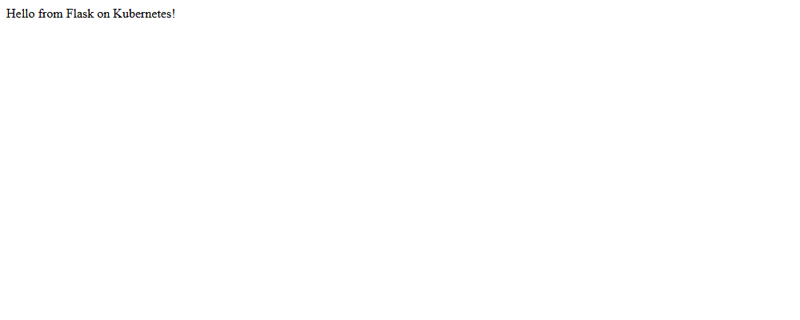

# Exercise 2 - Deploy a Flask app on Minikube using kubectl and yaml

## Aim
To build a docker image of a simple Flask app using minikube's docker daemon, deploy it on
minikube using a Deployment YAML file, and access it using a NodePort service.

## Files
- `app.py` - Flask app that returns "Hello from Flask on Kubernetes!" on port 15000
- `Dockerfile` - builds the flask-app image from python:3.8-slim
- `flask-deployment.yaml` - Deployment (flask-app) and NodePort Service (flask-app-service)
- `commands.ps1` - all the commands I used
- `flask-output.png` - screenshot of the flask app page

Notes:
- The exercise builds the image as `flask-app` but the YAML uses `flask-app:latest`. I built it as
  `flask-app:latest` so the tag is same as the YAML file.
- The exercise uses `eval $(minikube docker-env)` which is for Linux. On Windows PowerShell I used
  `& minikube -p minikube docker-env --shell powershell | Invoke-Expression`.
- `flask-deployment.yaml` first had only the Deployment part (Step 5). In Step 13 the Service part was
  added to the same file. The file in this folder is the final one.

## Software used
- Windows 11 (PowerShell)
- Docker Desktop 29.8.2
- minikube v1.38.1 (docker driver)
- kubectl v1.36.4

## Procedure
1. Start minikube (it was already running from exercise 1)
   ```powershell
   minikube start --driver=docker
   ```
2. Create `app.py`
3. Create `Dockerfile`
4. Point docker to minikube's docker daemon and build the image
   ```powershell
   minikube -p minikube docker-env --shell powershell
   & minikube -p minikube docker-env --shell powershell | Invoke-Expression
   docker build -t flask-app:latest .
   docker images flask-app
   ```
5. Create `flask-deployment.yaml` with the Deployment part (`imagePullPolicy: Never` so it uses the local image)
6. Deploy the app
   ```powershell
   kubectl apply -f flask-deployment.yaml
   ```
7. Check deployment status
   ```powershell
   kubectl get deployments
   ```
8. Check the pods created by the deployment
   ```powershell
   kubectl get pods -l app=flask-app
   ```
9. Describe the deployment
   ```powershell
   kubectl describe deployment flask-app
   ```
10. View the logs of the pod
    ```powershell
    kubectl logs flask-app-6d58f88547-hvwbs
    ```
    (the pod name is different every time, take it from `kubectl get pods -l app=flask-app`)
11. Check services
    ```powershell
    kubectl get services
    ```
12. Try to access the app on port 15000
    ```powershell
    curl.exe http://127.0.0.1:15000
    ```
13. Add the Service part to `flask-deployment.yaml`, apply again and access the app
    ```powershell
    kubectl apply -f flask-deployment.yaml
    kubectl get services
    minikube service flask-app-service --url
    curl.exe http://127.0.0.1:54995
    ```
    (54995 is the tunnel port from `minikube service --url`, it changes every time)

## Output

**Step 4 - minikube docker-env**
```
$Env:DOCKER_TLS_VERIFY = "1"
$Env:DOCKER_HOST = "tcp://127.0.0.1:63486"
$Env:DOCKER_CERT_PATH = "C:\Users\vaibh\.minikube\certs"
$Env:MINIKUBE_ACTIVE_DOCKERD = "minikube"
# To point your shell to minikube's docker-daemon, run:
# & minikube -p minikube docker-env --shell powershell | Invoke-Expression
```

**docker build -t flask-app:latest .** (layer download progress lines removed)
```
#0 building with "default" instance using docker driver

#1 [internal] load build definition from Dockerfile
#1 transferring dockerfile: 130B 0.0s done
#1 DONE 0.1s

#2 [internal] load metadata for docker.io/library/python:3.8-slim
#2 DONE 3.1s

#4 [internal] load .dockerignore
#4 transferring context: 2B done
#4 DONE 0.1s

#5 [internal] load build context
#5 transferring context: 766B 0.0s done
#5 DONE 0.1s

#6 [1/4] FROM docker.io/library/python:3.8-slim@sha256:1d52838af602b4b5a831beb13a0e4d073280665ea7be7f69ce2382f29c5a613f
#6 DONE 7.9s

#7 [2/4] WORKDIR /app
#7 DONE 0.3s

#8 [3/4] COPY . /app
#8 DONE 0.1s

#9 [4/4] RUN pip install flask
#9 2.540 Collecting flask
#9 2.658   Downloading flask-3.0.3-py3-none-any.whl (101 kB)
#9 4.064 Installing collected packages: zipp, MarkupSafe, itsdangerous, click, blinker, Werkzeug, Jinja2, importlib-metadata, flask
#9 4.657 Successfully installed Jinja2-3.1.6 MarkupSafe-2.1.5 Werkzeug-3.0.6 blinker-1.8.2 click-8.1.8 flask-3.0.3 importlib-metadata-8.5.0 itsdangerous-2.2.0 zipp-3.20.2
#9 4.657 WARNING: Running pip as the 'root' user can result in broken permissions and conflicting behaviour with the system package manager. It is recommended to use a virtual environment instead: https://pip.pypa.io/warnings/venv
#9 4.856 
#9 4.856 [notice] A new release of pip is available: 23.0.1 -> 25.0.1
#9 4.856 [notice] To update, run: pip install --upgrade pip
#9 DONE 5.0s

#10 exporting to image
#10 exporting layers
#10 exporting layers 0.3s done
#10 writing image sha256:c5ff1f7d53be16846fe745f28d5a51980548cbf43561bf5737821e36be317a1a done
#10 naming to docker.io/library/flask-app:latest done
#10 DONE 0.3s
```

**docker images flask-app**
```
IMAGE              ID             DISK USAGE   CONTENT SIZE   EXTRA
flask-app:latest   c5ff1f7d53be        136MB             0B
```

**Step 6 - kubectl apply**
```
deployment.apps/flask-app created
```

**Step 7 - kubectl get deployments**
```
NAME        READY   UP-TO-DATE   AVAILABLE   AGE
flask-app   1/1     1            1           2s
```

**Step 8 - kubectl get pods -l app=flask-app**
```
NAME                         READY   STATUS    RESTARTS   AGE
flask-app-6d58f88547-hvwbs   1/1     Running   0          2s
```

**Step 9 - kubectl describe deployment flask-app**
```
Name:                   flask-app
Namespace:              default
CreationTimestamp:      Tue, 20 Oct 2026 23:06:17 +0530
Labels:                 <none>
Annotations:            deployment.kubernetes.io/revision: 1
Selector:               app=flask-app
Replicas:               1 desired | 1 updated | 1 total | 1 available | 0 unavailable
StrategyType:           RollingUpdate
MinReadySeconds:        0
RollingUpdateStrategy:  25% max unavailable, 25% max surge
Pod Template:
  Labels:  app=flask-app
  Containers:
   flask-app:
    Image:         flask-app:latest
    Port:          15000/TCP
    Host Port:     0/TCP
    Environment:   <none>
    Mounts:        <none>
  Volumes:         <none>
  Node-Selectors:  <none>
  Tolerations:     <none>
Conditions:
  Type           Status  Reason
  ----           ------  ------
  Available      True    MinimumReplicasAvailable
  Progressing    True    NewReplicaSetAvailable
OldReplicaSets:  <none>
NewReplicaSet:   flask-app-6d58f88547 (1/1 replicas created)
Events:
  Type    Reason             Age   From                   Message
  ----    ------             ----  ----                   -------
  Normal  ScalingReplicaSet  2s    deployment-controller  Scaled up replica set flask-app-6d58f88547 from 0 to 1
```

**Step 10 - kubectl logs flask-app-6d58f88547-hvwbs**
```
 * Serving Flask app 'app'
 * Debug mode: off
WARNING: This is a development server. Do not use it in a production deployment. Use a production WSGI server instead.
 * Running on all addresses (0.0.0.0)
 * Running on http://127.0.0.1:15000
 * Running on http://10.244.0.5:15000
Press CTRL+C to quit
```

**Step 11 - kubectl get services**
```
NAME         TYPE        CLUSTER-IP   EXTERNAL-IP   PORT(S)   AGE
kubernetes   ClusterIP   10.96.0.1    <none>        443/TCP   50m
```

**Step 12 - curl.exe http://127.0.0.1:15000**
```
curl: (7) Failed to connect to 127.0.0.1 port 15000 after 2042 ms: Could not connect to server
```

**Step 13 - kubectl apply after adding the Service**
```
deployment.apps/flask-app unchanged
service/flask-app-service created
```

kubectl get services
```
NAME                TYPE        CLUSTER-IP      EXTERNAL-IP   PORT(S)           AGE
flask-app-service   NodePort    10.100.186.96   <none>        15000:32561/TCP   0s
kubernetes          ClusterIP   10.96.0.1       <none>        443/TCP           50m
```

minikube service flask-app-service --url
```
http://127.0.0.1:54995
❗  Because you are using a Docker driver on windows, the terminal needs to be open to run it.
```

curl.exe http://127.0.0.1:54995 (from another terminal)
```
Hello from Flask on Kubernetes!
```

Page at http://127.0.0.1:54995:



## Observations
- The image was built inside minikube's docker, so with `imagePullPolicy: Never` the pod used the
  local `flask-app:latest` image and did not try to pull from Docker Hub.
- The deployment created a ReplicaSet `flask-app-6d58f88547` and it created 1 pod which was Running.
- The logs show flask running on port 15000 inside the pod (pod IP 10.244.0.5).
- In step 12 curl to 127.0.0.1:15000 failed, because port 15000 is only inside the cluster and not
  exposed outside.
- After adding the NodePort service, port 15000 got NodePort 32561. With docker driver on Windows
  `minikube service --url` gave a tunnel URL 127.0.0.1:54995 and curl to it worked.
- Running `kubectl apply` again showed `deployment.apps/flask-app unchanged` because only the Service
  part was new.

## Result
The Flask app was built as a docker image using minikube's docker daemon, deployed on minikube using
a Deployment YAML file and accessed successfully using a NodePort service.

## Cleanup
Stopped the `minikube service` tunnel (Ctrl+C) and deleted the deployment and service:
```powershell
kubectl delete -f flask-deployment.yaml
kubectl get pods
```
Output:
```
deployment.apps "flask-app" deleted from default namespace
service "flask-app-service" deleted from default namespace
```
```
No resources found in default namespace.
```
