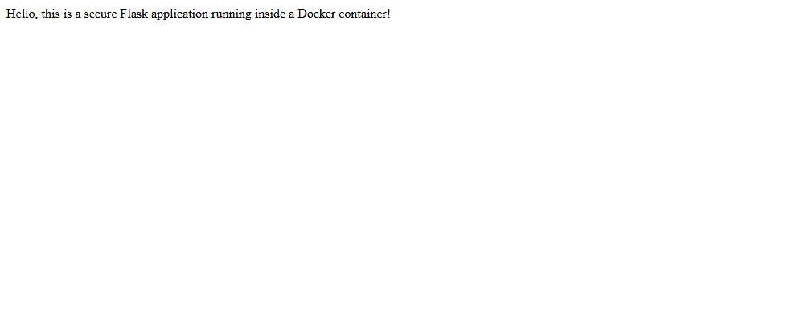

# Exercise 5 - Docker Security with AppArmor and Python

## Aim
To containerize a Flask app, write an AppArmor profile that blocks access to sensitive directories and
blocks running binaries, apply it to the container using `--security-opt` and the Docker SDK for Python,
and test the restricted actions.

## Files
- `app.py` - simple Flask app on port 5000
- `Dockerfile` - builds the `flask-apparmor` image from python:3.8-slim
- `my-apparmor-profile` - AppArmor profile (denies read of /etc, rw of /var, exec of /bin and /usr/bin)
- `apply_apparmor.py` - Docker SDK script that builds the image, runs it with the profile and prints SecurityOpt
- `test_restricted_actions.py` - Docker SDK script that tries `cat /etc/passwd` and `/bin/bash` in the container
- `commands.ps1` - all the commands I used
- `flask-apparmor.png` - screenshot of the Flask app page

**Important note:** My laptop runs Windows 11 with Docker Desktop. Docker Desktop runs on the WSL2
kernel (`6.18.54.1-microsoft-standard-WSL2`) and AppArmor is **disabled** in this kernel. So the profile
could not be loaded and it was **not enforced**. I still ran all the steps and the output below is the
real output from my laptop. To really see the profile blocking things, it has to be run on a Linux machine
with AppArmor enabled (for example Ubuntu).

Notes (changes from the exercise file):
- In the exercise the profile is written as `/usr/bin/python3 { ... }`. That makes the profile name
  `/usr/bin/python3`, but docker looks for a profile by name (`apparmor=my-apparmor-profile`). So I wrote
  it as `profile my-apparmor-profile flags=(attach_disconnected,mediate_deleted) { ... }`.
- AppArmor denies everything that is not allowed. With only `/app/** rwk` allowed, python itself could not
  start. So I added `#include <abstractions/base>` and `file,` (allow normal file access). The `deny` rules
  still take priority over `file,`.
- `apparmor_parser` is a Linux tool and is not there on Windows, so I ran it inside a privileged
  `ubuntu:24.04` container which uses the same kernel as Docker Desktop.
- I installed the Docker SDK (`pip install docker`) in a separate python virtual environment.

## Software used
- Windows 11 (PowerShell)
- Docker Desktop 29.8.2 (WSL2 kernel 6.18.54.1-microsoft-standard-WSL2)
- Python 3.11.7, Docker SDK for Python 7.2.0

## Procedure
1. Check if Docker supports AppArmor on this machine
   ```powershell
   docker info --format "{{json .SecurityOptions}}"
   docker info --format "{{.KernelVersion}} | {{.OperatingSystem}}"
   docker run --rm --privileged --pid=host alpine:3.20 sh -c "cat /sys/module/apparmor/parameters/enabled"
   ```
2. Create `app.py` and `Dockerfile` (Task 1 and 2) and build the image
   ```powershell
   docker build -t flask-apparmor .
   ```
3. Create `my-apparmor-profile` and try to load it with apparmor_parser (Task 3)
   ```powershell
   docker run --rm --privileged -v "${PWD}\my-apparmor-profile:/etc/apparmor.d/my-apparmor-profile:ro" ubuntu:24.04 bash -c "apt-get update -qq && apt-get install -y -qq apparmor apparmor-utils; apparmor_parser --version | head -1; apparmor_parser -r /etc/apparmor.d/my-apparmor-profile; aa-enabled"
   ```
4. Run the container with the profile and check if it is applied (Task 3)
   ```powershell
   docker run -d --name flask-aa --security-opt="apparmor=my-apparmor-profile" -p 5000:5000 flask-apparmor
   curl.exe -s http://localhost:5000/
   docker inspect flask-aa --format "SecurityOpt={{json .HostConfig.SecurityOpt}} AppArmorProfile={{json .AppArmorProfile}}"
   docker exec flask-aa sh -c "head -3 /etc/passwd"
   docker exec flask-aa cat /proc/self/attr/current
   docker rm -f flask-aa
   ```
5. Install the Docker SDK and run `apply_apparmor.py` (Task 4)
   ```powershell
   python -m venv venv
   .\venv\Scripts\python.exe -m pip install docker
   .\venv\Scripts\python.exe apply_apparmor.py
   ```
6. Run `test_restricted_actions.py` (Task 5)
   ```powershell
   .\venv\Scripts\python.exe test_restricted_actions.py
   ```

## Output

**Step 1 - AppArmor support check**
```
["name=seccomp,profile=builtin","name=cgroupns"]
6.18.54.1-microsoft-standard-WSL2 | Docker Desktop
```
`/sys/module/apparmor/parameters/enabled` (Y means AppArmor is on, N means it is off)
```
N
```

**Step 2 - docker build -t flask-apparmor .**

First try failed because of a network timeout to Docker Hub:
```
#2 ERROR: failed to authorize: failed to fetch oauth token: Post "https://auth.docker.io/token": net/http: TLS handshake timeout
ERROR: failed to build: failed to solve: failed to fetch oauth token: Post "https://auth.docker.io/token": net/http: TLS handshake timeout
```
Second try worked (layer and pip download lines removed):
```
#0 building with "desktop-linux" instance using docker driver
#1 [internal] load build definition from Dockerfile
#1 transferring dockerfile: 386B 0.0s done
#1 DONE 0.0s
#3 [internal] load metadata for docker.io/library/python:3.8-slim
#3 DONE 2.7s
#6 [1/4] FROM docker.io/library/python:3.8-slim@sha256:1d52838af602b4b5a831beb13a0e4d073280665ea7be7f69ce2382f29c5a613f
#6 DONE 20.2s
#7 [2/4] WORKDIR /app
#7 DONE 0.2s
#8 [3/4] COPY . /app
#8 DONE 0.1s
#9 [4/4] RUN pip install flask
#9 2.605 Collecting flask
#9 4.582 Installing collected packages: zipp, MarkupSafe, itsdangerous, click, blinker, Werkzeug, Jinja2, importlib-metadata, flask
#9 5.167 Successfully installed Jinja2-3.1.6 MarkupSafe-2.1.5 Werkzeug-3.0.6 blinker-1.8.2 click-8.1.8 flask-3.0.3 importlib-metadata-8.5.0 itsdangerous-2.2.0 zipp-3.20.2
#9 DONE 5.6s
#10 exporting to image
#10 naming to docker.io/library/flask-apparmor:latest done
#10 DONE 3.8s
```
```
IMAGE                   ID             DISK USAGE   CONTENT SIZE   EXTRA
flask-apparmor:latest   d29f7c42d604        208MB         51.9MB
```

**Step 3 - apparmor_parser -r /etc/apparmor.d/my-apparmor-profile**
```
### apparmor_parser --version
AppArmor parser version 4.0.1
### apparmor_parser -r /etc/apparmor.d/my-apparmor-profile
Cache read/write disabled: interface file missing. (Kernel needs AppArmor 2.4 compatibility patch.)
Use --subdomainfs to override.
exit code: 1
### aa-enabled
No - disabled at boot.
exit code: 1
```

**Step 4 - docker run with --security-opt="apparmor=my-apparmor-profile"**
```
f8eccb8556a9f82708c2932ea6b7fea7532ee56f41e7372f7fcc6db3cb18e0b4
```
```
NAMES      STATUS         PORTS
flask-aa   Up 4 seconds   0.0.0.0:5000->5000/tcp, [::]:5000->5000/tcp
```
curl.exe -s http://localhost:5000/
```
Hello, this is a secure Flask application running inside a Docker container!
```

Page at http://localhost:5000/:



docker inspect
```
SecurityOpt=["apparmor=my-apparmor-profile"] AppArmorProfile=""
```
docker exec flask-aa sh -c "head -3 /etc/passwd"
```
root:x:0:0:root:/root:/bin/bash
daemon:x:1:1:daemon:/usr/sbin:/usr/sbin/nologin
bin:x:2:2:bin:/bin:/usr/sbin/nologin
exit code: 0
```
docker exec flask-aa cat /proc/self/attr/current
```
kernel
```

**Step 5 - pip install docker**
```
Name: docker
Version: 7.2.0
```

python apply_apparmor.py
```
Container started: b0bd48db0f4b
AppArmor profile applied: ['apparmor=my-apparmor-profile']
```

**Step 6 - python test_restricted_actions.py**
```
Attempt to read /etc/passwd: Exit Code 0, Output: root:x:0:0:root:/root:/bin/bash
daemon:x:1:1:daemon:/usr/sbin:/usr/sbin/nologin
bin:x:2:2:bin:/bin:/usr/sbin/nologin
sys:x:3:3:sys:/dev:/usr/sbin/nologin
sync:x:4:65534:sync:/bin:/bin/sync
games:x:5:60:games:/usr/games:/usr/sbin/nologin
man:x:6:12:man:/var/cache/man:/usr/sbin/nologin
lp:x:7:7:lp:/var/spool/lpd:/usr/sbin/nologin
mail:x:8:8:mail:/var/mail:/usr/sbin/nologin
news:x:9:9:news:/var/spool/news:/usr/sbin/nologin
uucp:x:10:10:uucp:/var/spool/uucp:/usr/sbin/nologin
proxy:x:13:13:proxy:/bin:/usr/sbin/nologin
www-data:x:33:33:www-data:/var/www:/usr/sbin/nologin
backup:x:34:34:backup:/var/backups:/usr/sbin/nologin
list:x:38:38:Mailing List Manager:/var/list:/usr/sbin/nologin
irc:x:39:39:ircd:/run/ircd:/usr/sbin/nologin
_apt:x:42:65534::/nonexistent:/usr/sbin/nologin
nobody:x:65534:65534:nobody:/nonexistent:/usr/sbin/nologin

Attempt to execute /bin/bash: Exit Code 0, Output: 
```

## Observations
- `docker info` shows only `seccomp` and `cgroupns` as security options, there is no `apparmor`.
  The kernel also says AppArmor enabled = `N`, and `aa-enabled` says `No - disabled at boot`.
- Because of this `apparmor_parser` could not load `my-apparmor-profile` into the kernel.
- Docker still accepted `--security-opt="apparmor=my-apparmor-profile"` and started the container without
  any error or warning. The Flask app worked on port 5000.
- `HostConfig.SecurityOpt` shows `apparmor=my-apparmor-profile`, but this is only the option we gave.
  The real `AppArmorProfile` field is empty and the process label is `kernel`, so the profile was not applied.
- So `apply_apparmor.py` printing `AppArmor profile applied` is not enough to prove that the profile is
  working. It only shows what was requested.
- In `test_restricted_actions.py`, reading `/etc/passwd` and running `/bin/bash` both gave exit code 0.
  On a Linux machine with AppArmor enabled these would be blocked (the exercise expects exit codes 1 and 126).
- To check properly, look at `docker inspect <container> --format "{{.AppArmorProfile}}"` and try the
  restricted action, not just `HostConfig.SecurityOpt`.

## Result
The Flask app was containerized and an AppArmor profile was written and applied using `--security-opt`
and the Docker SDK for Python. On my Windows laptop with Docker Desktop, AppArmor is disabled in the
kernel, so the profile could not be loaded and the restricted actions were not blocked. The exercise
needs a Linux host with AppArmor enabled to see the restrictions working.

## Cleanup
The scripts stop the containers but do not remove them, so I removed them and the image:
```powershell
docker rm 645623eefc8d b0bd48db0f4b
docker rmi flask-apparmor
docker ps -a --filter ancestor=flask-apparmor
```
Output:
```
645623eefc8d
b0bd48db0f4b
Untagged: flask-apparmor:latest
Deleted: sha256:c9e612a2aaccb4e8224ba4671b091d6db72cf83f417e3af05dfa6db233d87c30
CONTAINER ID   IMAGE     COMMAND   CREATED   STATUS    PORTS     NAMES
```
The `flask-aa` container from Step 4 was removed with `docker rm -f flask-aa`.
